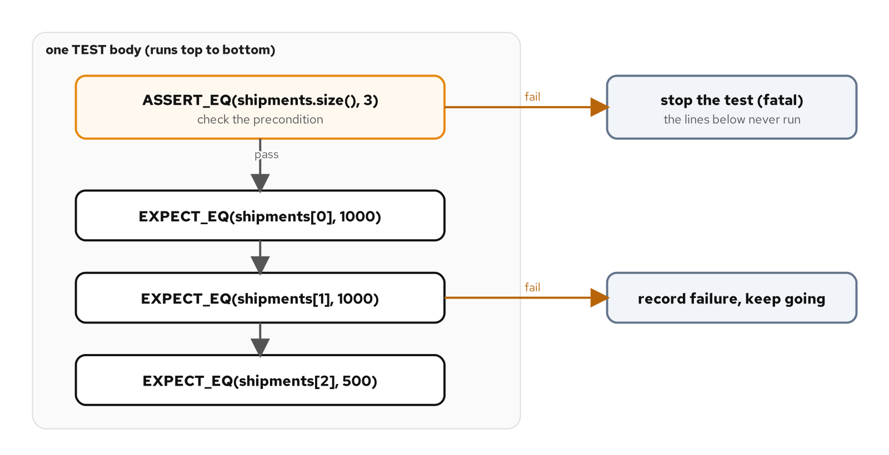

# Assertions and expectations

## Learning objectives

By the end of this chapter you can:

- Choose between `ASSERT_*` and `EXPECT_*` by whether the rest of the test can run after a failure.
- Use the `ASSERT`-then-`EXPECT` pattern to guard indexing and dereferences.
- Reach for the right assertion macro: equality, ordering, boolean, string, floating-point, and exception checks.
- Explain why floating-point comparisons use `EXPECT_NEAR` or `EXPECT_FLOAT_EQ` rather than `EXPECT_EQ`.
- Group related cases into a suite and name each case for the behavior it pins down.

## Diagram



## Why this matters

Chapter 3 wrote cases with one assertion each. Real tests make several checks in a row, and the moment they do, a question appears: when one check fails, should the test stop, or keep going and report the rest. GoogleTest answers it with two families of the same macros. `EXPECT_*` records a failure and continues; `ASSERT_*` records a failure and returns from the test immediately. Picking the right one is the difference between a clear failure report and a crash inside your own test. Get it right and a failing suite reads like a punch list; get it wrong and one broken line takes the rest of the test down with it before it can report anything useful.

The code is in `examples/04-assertions/`. The run script there builds and runs it; its `README.md` covers how to drive each lane.

## Fatal and non-fatal

The default choice is `EXPECT_*`. When a test checks several independent facts, letting them all run gives you every failure from one run rather than one failure per rebuild. A test that checks three fields of a result should use three `EXPECT_EQ` calls, so a single run tells you which fields are wrong, not just the first.

`ASSERT_*` is for a check whose failure makes the rest of the test meaningless or unsafe. The classic case is a precondition the later lines depend on. If a test reads `result[2]`, it has to know the result holds at least three elements first, because indexing past the end of a `std::vector` is undefined behavior: not a clean failure, but a read of whatever memory lies beyond the vector. An `ASSERT_EQ` on the size stops the test before that happens. Figure 4.1 shows the split: the `ASSERT` either passes and flow continues down, or fails and the test returns, so the `EXPECT` lines below never execute against a vector that can't satisfy them.

The same reasoning covers pointers. A test that fetches an object and then checks its fields should `ASSERT_NE(ptr, nullptr)` before it touches `ptr->field`, because a null dereference is undefined behavior just as an out-of-bounds index is. The rule generalizes: when a later line would be unsafe or meaningless after a failure, that failure is fatal, and everything else stays an expectation. Expectations also accumulate, so a test with four `EXPECT`s can report up to four distinct problems from one run, which is faster to act on than fixing one, rebuilding, and finding the next.

The opposite mistake is the more common one: reaching for `ASSERT` everywhere. A suite built entirely from `ASSERT`s stops at the first failure in each test and hides whatever else is wrong, so you fix one problem per run and never see the others until you get there. Keep `ASSERT` for the preconditions that protect later lines, and let `EXPECT` carry the ordinary checks.

One consequence catches people out. Because `ASSERT_*` returns from the current function, it only works inside the test body, not inside a helper function the test calls. A helper that needs to abort has to signal back some other way, a point the fixtures chapter comes back to. For now the rule is simple: `ASSERT` what the rest of the test depends on, `EXPECT` everything else.

## How the code works

### The function under test

`shipping::split_into_shipments` divides a total weight into shipments no heavier than a per-shipment maximum, and returns them in a vector:

```cpp
std::vector<int> split_into_shipments(int total_grams, int max_grams) {
  if (max_grams <= 0) {
    throw std::invalid_argument("max_grams must be positive");
  }
  if (total_grams < 0) {
    throw std::invalid_argument("total_grams must be non-negative");
  }

  std::vector<int> shipments;
  int remaining = total_grams;
  while (remaining > max_grams) {
    shipments.push_back(max_grams);
    remaining -= max_grams;
  }
  if (remaining > 0) {
    shipments.push_back(remaining);
  }
  return shipments;
}
```

Each full shipment takes `max_grams`, and the final `if` adds the remainder when there is one, so an exact multiple leaves no trailing partial shipment and a zero total returns an empty vector. The return type is the reason this example teaches assertions well: a vector has both a size and elements, and those are checked differently. The loop fills whole shipments while more than `max_grams` remains, and the trailing `if` appends the leftover; walking those two steps is also how you pick inputs that land on each branch, the case-choosing discipline from the previous chapter.

### Assert the size, then expect the elements

The first case shows the pattern in full:

```cpp
TEST(SplitIntoShipments, FillsEachShipmentThenLeavesTheRemainder) {
  const auto shipments = shipping::split_into_shipments(2500, 1000);
  // Fatal: every line below indexes into the vector.
  ASSERT_EQ(shipments.size(), 3U);
  EXPECT_EQ(shipments[0], 1000);
  EXPECT_EQ(shipments[1], 1000);
  EXPECT_EQ(shipments[2], 500);
}
```

The `ASSERT_EQ` on `shipments.size()` has to be fatal: if the split produced the wrong number of shipments, `shipments[2]` would read past the end of the vector, so the test must stop at the size check rather than run the element checks against memory that isn't there. Once the size is confirmed, the three `EXPECT_EQ` calls check the contents, and because they're non-fatal, a run reports every element that's wrong at once. The result is held in `const auto` because the test only reads it, and `const` says so.

The literal is `3U`, not `3`, because `std::vector::size()` returns an unsigned type and comparing it against a signed `3` would draw a sign-conversion warning, which this build treats as an error. Matching the literal's type to the value's is the small habit that keeps the comparison clean.

### Booleans and exceptions

Not every check is an equality. The remaining cases reach for other macros:

```cpp
TEST(SplitIntoShipments, ReturnsNoShipmentsForZeroWeight) {
  EXPECT_TRUE(shipping::split_into_shipments(0, 1000).empty());
}

TEST(SplitIntoShipments, RejectsANonPositiveMax) {
  EXPECT_THROW((void)shipping::split_into_shipments(1000, 0),
               std::invalid_argument);
}
```

`EXPECT_TRUE` checks a boolean condition, here that the returned vector is empty. `EXPECT_THROW` checks that a statement throws an exception of a named type, which is how you test a failure path: the call with a zero maximum must throw `std::invalid_argument`, and the test fails if it throws something else or nothing at all. The `(void)` cast discards the return value, which the function marks `[[nodiscard]]`; without the cast, ignoring the result would itself be a warning, and the warning would become a build error.

### Comparing a whole container

The size-then-elements pattern isn't the only way to check a vector. Because `std::vector` has an `operator==`, a single assertion can compare the whole thing:

```cpp
const std::vector<int> expected{1000, 1000, 500};
EXPECT_EQ(shipping::split_into_shipments(2500, 1000), expected);
```

The expected value goes in a named local rather than inline, because a braced list written directly inside `EXPECT_EQ(a, b)` has its commas read as extra macro arguments; the local sidesteps that and reads more clearly. This form is shorter and checks size and contents together. The trade-off is the failure message: a whole-vector mismatch prints both vectors and leaves you to find the differing element, where the size-then-elements form names the exact index. For a short, fixed expected value the one-liner wins; when you want a failure to point at a single element, the longer form earns its lines. GoogleMock's container matchers, covered in the mocking chapters, give a third option that pairs a compact call with an element-level message. For the message to read well, the element type has to be printable, which `int` is; a vector of a custom type would print as raw bytes unless the type has an `operator<<`, the same requirement any `EXPECT_EQ` places on its operands.

### Adding context to a failure

Any assertion takes a trailing `<<` stream, appended to the failure message when the check fails and ignored when it passes:

```cpp
EXPECT_EQ(shipments.size(), 3U) << "split of 2500 g at 1000 g per shipment";
```

When a value isn't obvious from the expression alone, or a check runs inside a loop over several inputs, a short note turns a bare mismatch into a message that names the scenario. Add it where the assertion's own text doesn't already say what went in; a well-named case and a clear expression often make it unnecessary. In a loop that checks many inputs, streaming the loop variable is the difference between a failure you can place and one that only says a number was wrong.

### The assertion vocabulary

Every macro comes in both a fatal `ASSERT_` and a non-fatal `EXPECT_` form. The ones worth knowing from the start:

| Non-fatal | Fatal | Checks |
|---|---|---|
| `EXPECT_EQ` / `EXPECT_NE` | `ASSERT_EQ` / `ASSERT_NE` | `a == b` / `a != b` |
| `EXPECT_LT` `LE` `GT` `GE` | `ASSERT_LT` `LE` `GT` `GE` | ordering: `<`, `<=`, `>`, `>=` |
| `EXPECT_TRUE` / `EXPECT_FALSE` | `ASSERT_TRUE` / `ASSERT_FALSE` | a boolean condition |
| `EXPECT_STREQ` / `EXPECT_STRNE` | `ASSERT_STREQ` / `ASSERT_STRNE` | two C strings, by content |
| `EXPECT_FLOAT_EQ` `DOUBLE_EQ` `NEAR` | `ASSERT_FLOAT_EQ` `DOUBLE_EQ` `NEAR` | floating-point, within tolerance |
| `EXPECT_THROW` `ANY_THROW` `NO_THROW` | `ASSERT_THROW` `ANY_THROW` `NO_THROW` | a statement throws, throws anything, or throws nothing |

Two rows need a word of care. For strings, `EXPECT_EQ` compares `std::string` values correctly, but on two `const char*` pointers it compares the addresses, not the text; `EXPECT_STREQ` compares the characters, which is almost always what you want for a C string. For floating-point, `EXPECT_EQ` is a trap: `0.1 + 0.2` is not exactly `0.3` in binary floating-point, so an exact equality fails on values that are correct to every digit that matters. `EXPECT_FLOAT_EQ` and `EXPECT_DOUBLE_EQ` compare within a few units in the last place, and `EXPECT_NEAR(a, b, tol)` lets you state an explicit tolerance.

Choosing fatal or non-fatal is independent of what you check: every row has both forms, and you pick per call by the same question of whether the test can go on. The exception rows are worth singling out, because without them, testing that a call throws means a hand-written `try`/`catch` with a `FAIL()` in the branch that should never run. `EXPECT_THROW` collapses that into one line, and `EXPECT_NO_THROW` asserts the opposite, that a call completes without throwing.

### Organizing cases into suites

The first argument to `TEST` is the suite name, and every case here shares `SplitIntoShipments`. GoogleTest groups output by suite, runs and filters by suite, and reports `SplitIntoShipments.ReturnsNoShipmentsForZeroWeight` as the full identity of a case. Keeping one suite per unit under test is the convention: it keeps related cases together in the report and lets you run just that unit's tests with a single filter. That filter is the suite name from the previous chapter: `--gtest_filter='SplitIntoShipments.*'` or `ctest -R SplitIntoShipments` runs every case in this suite and nothing else. The cases stay independent of one another; the suite is a naming and grouping device, not shared state. When several cases need the same setup, that shared setup is what fixtures are for, which is the next chapter.

> **AI sidebar.** Left to its own habits, an assistant picks `ASSERT` or `EXPECT` by rote rather than by whether the test can keep going, and it often makes everything an `ASSERT`, so the first failure hides the rest. It also tends to use `EXPECT_EQ` on C strings and on floating-point values, where `EXPECT_STREQ` and `EXPECT_NEAR` are the right tools. Check that a precondition the later lines depend on is the `ASSERT` and the ordinary checks are `EXPECT`, and that any string or float comparison uses the macro meant for it rather than a raw `==` that compares pointers or demands exact bits.

## Build, run, observe

Run the default lane:

```bash
[host]$ cd examples/04-assertions
[host]$ ./demo.sh test
```

Five cases pass. To see the fatal-versus-non-fatal difference, break the split so it drops the remainder and returns two shipments where the first case expects three. The `ASSERT_EQ` on the size catches it:

```console
tests/consolidation_test.cpp:11: Failure
Expected equality of these values:
  shipments.size()
    Which is: 2
  3U
    Which is: 3
[  FAILED  ] SplitIntoShipments.FillsEachShipmentThenLeavesTheRemainder
```

The report shows one failure for that test, not three. The `ASSERT_EQ` on line 11 returned from the test the moment the size didn't match, so the three `EXPECT_EQ` lines below it never ran. Had those been `ASSERT`s guarding nothing, or had the size check been an `EXPECT`, the test would have run on and indexed a two-element vector at `[2]`, which is the undefined read the `ASSERT` exists to prevent. The message itself repays reading: `Expected equality of these values` names the two sides, and each `Which is:` line gives the value computed for the expression above it, so `shipments.size()` was 2 where the expected `3U` is 3. The file and line point straight at the assertion, not into GoogleTest's macros. The suite also passes under `./demo.sh asan` and `./demo.sh tsan`.

## Cross-check

Confirm the five cases the source declares are the five the binary holds:

```console
[host]$ ./build/unit_tests --gtest_list_tests
SplitIntoShipments.
  FillsEachShipmentThenLeavesTheRemainder
  LeavesNoTrailingShipmentOnAnExactMultiple
  AWholeVectorCanBeComparedInOneAssertion
  ReturnsNoShipmentsForZeroWeight
  RejectsANonPositiveMax
```

The five cases under the one suite match the five `TEST` macros in `consolidation_test.cpp`, so `gtest_discover_tests` registered the suite exactly as written.

## What you learned

- `EXPECT_*` records a failure and continues; `ASSERT_*` returns from the test, so use it for a precondition the rest of the test depends on.
- `ASSERT` the size of a container before indexing it, then `EXPECT` the elements, so a wrong shape fails cleanly instead of reading out of bounds.
- The macro families cover equality, ordering, booleans, strings, floating-point, and exceptions; use `STREQ` for C strings and `FLOAT_EQ`/`NEAR` for floating-point, never `EXPECT_EQ`.
- A suite groups a unit's cases under one name; shared setup across them is the job of a fixture.

The next chapter introduces fixtures, where `TEST_F` gives a group of cases the same prepared state through `SetUp` and `TearDown`.

## For deeper coverage

- The [GoogleTest assertions reference](https://google.github.io/googletest/reference/assertions.html): every macro, its fatal and non-fatal forms, and the string and floating-point variants.
- The [GoogleTest primer](https://google.github.io/googletest/primer.html): the `ASSERT` versus `EXPECT` distinction and suite organization.
- *The Art of Software Testing* by Glenford Myers, Tom Badgett, and Corey Sandler ([Wiley](https://www.wiley.com/en-us/The+Art+of+Software+Testing%2C+3rd+Edition-p-9781118031964)): why boundary cases like the exact-multiple split deserve their own tests.
- The full reading list lives on the bibliography page.

---

*Verification status: verified. On Fedora 44 (Clang 22.1.8, CMake 4.3.0, Conan 2.33.0, GoogleTest 1.18.0), `examples/04-assertions` builds and reports 4/4 on `./demo.sh test`, `asan`, and `tsan`; the fatal-assertion failure shown was produced by dropping the remainder, then reverted; `--gtest_list_tests` lists the four cases shown. Re-run all lanes before a release.*
