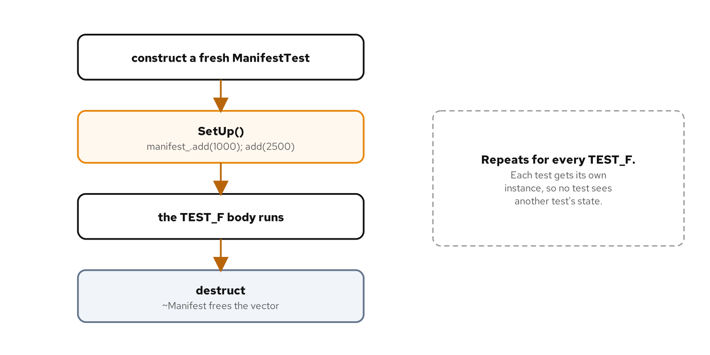

# Fixtures

## Learning objectives

By the end of this chapter you can:

- Write a fixture class and a `TEST_F` that runs against it.
- Use `SetUp` to prepare state once per test and explain why every test gets a fresh instance.
- Rely on the fixture's destructor for cleanup, and say when `TearDown` is still needed.
- Decide when a fixture is worth it over a plain local variable in each test.
- Explain why a fixture's shared state is `protected`.

## Diagram



## Why this matters

Chapter 4 grouped cases into a suite by giving them the same name. A suite groups, but it shares nothing: each case still builds its own starting state from scratch. The moment several cases need the same prepared object, copying that setup into every case is both noise and a maintenance trap, because a change to the setup has to be made in every copy. A fixture moves that shared setup to one place and hands each test a fresh copy of it.

The maintenance angle is the quiet payoff. When the way you build the starting state changes, adding a field, loading one more parcel, renaming a method, a fixture means one edit in `SetUp` instead of the same edit in every case that built its own. The more cases a suite grows, the more a fixture saves, and the less likely it is that one case drifts out of step because someone updated four setups and missed the fifth.

The code is in `examples/05-fixtures/`. The run script there builds and runs it; its `README.md` covers how to drive each lane.

## What a fixture is

A fixture is a class that holds the state a group of tests share, plus the code that prepares it. You write `TEST_F` instead of `TEST`, name the fixture class as the first argument, and the test body runs as a method of a fresh instance of that class. GoogleTest constructs that instance, calls its `SetUp`, runs the body, and destroys the instance, and it does this once for every case. Figure 5.1 traces the cycle: construct, set up, run, destroy, repeated per test. No two tests share an instance, so nothing one test does to the state can reach another.

That per-test freshness is the property that makes a suite of tests trustworthy. Tests that shared one object would pass or fail depending on the order they ran in, and a failure in one could be the fault of another that ran before it. A fixture rebuilt for each case removes that whole class of problem: every test starts from the same known state, and ends without leaving a trace.

The two preparation hooks exist for different reasons. Construction runs first and brings the members into being; `SetUp` runs next and can do work a constructor should not, including calling virtual methods and making assertions that GoogleTest will report. Because both run before every body, the body can assume its world is already built and read the members as though a line just above had set them up.

In the arrange-act-assert shape from the earlier chapters, `SetUp` is the shared arrange step: the part every case in the suite would otherwise repeat, lifted out so each body is left with its own act and assert. A case that needs a little extra arrangement does it at the top of its body, on top of what `SetUp` already built.

## How the code works

### The class under test

`shipping::Manifest` accumulates the parcels loaded for one truck:

```cpp
class Manifest {
 public:
  void add(int weight_grams);   // throws std::invalid_argument if not positive
  [[nodiscard]] int count() const;
  [[nodiscard]] int total_grams() const;
  [[nodiscard]] bool is_empty() const;

 private:
  std::vector<int> weights_;
};
```

It holds a vector of parcel weights and reports their count and sum. It's a small stateful object, which is exactly the shape that benefits from a fixture: several tests want to start from a manifest with a few parcels already on it.

### The fixture

A fixture derives from `::testing::Test` and holds the shared state as member data:

```cpp
class ManifestTest : public ::testing::Test {
 protected:
  void SetUp() override {
    manifest_.add(1000);
    manifest_.add(2500);
  }

  shipping::Manifest manifest_;
};
```

`SetUp` runs before each test body and loads two parcels, so every case starts from a manifest holding 1000 and 2500 grams. The members are `protected` because a `TEST_F` body runs as a method of a class GoogleTest derives from the fixture, and a derived class can reach a protected member but not a private one. That visibility is the framework's requirement, not a style choice, so `manifest_` sits in the `protected` section where the test bodies can use it.

There's no constructor here because a default-constructed `Manifest` is already the right empty starting point, and `SetUp` does the rest. A fixture can use a constructor instead of `SetUp` for state that has no default, and the two differ in one way worth knowing: an exception or a fatal assertion inside a constructor can't be caught and reported the way GoogleTest catches one inside `SetUp`, so `SetUp` is the safer home for preparation that might fail.

### The tests

Each case is a `TEST_F` naming the fixture, and each reads `manifest_` as though it were a local:

```cpp
TEST_F(ManifestTest, StartsFromTheParcelsAddedInSetUp) {
  EXPECT_EQ(manifest_.count(), 2);
  EXPECT_EQ(manifest_.total_grams(), 3500);
  EXPECT_FALSE(manifest_.is_empty());
}

TEST_F(ManifestTest, AddingAParcelUpdatesCountAndTotal) {
  manifest_.add(500);
  EXPECT_EQ(manifest_.count(), 3);
  EXPECT_EQ(manifest_.total_grams(), 4000);
}
```

The first case checks the state `SetUp` built: two parcels, a combined 3500 grams, and a manifest that reports itself non-empty. Each assertion confirms one thing `SetUp` was meant to establish, so if `SetUp` ever stops doing its job, this case is the one that says so. The second adds a parcel and checks that the count and total moved, working from the same two-parcel start without repeating the `add` calls. The `manifest_` each one touches is its own: the second case's `add(500)` happens on an instance that didn't exist when the first case ran and won't exist when the next one does.

The third case exists to prove exactly that isolation:

```cpp
TEST_F(ManifestTest, EachTestStartsFromAFreshFixture) {
  manifest_.add(500);
  EXPECT_EQ(manifest_.count(), 3);
}
```

It makes the same `add(500)` call as the case before it and still expects a count of 3, not 4. If the two cases shared one manifest, the second to run would see five parcels; because each gets a fresh fixture, both see three. The last case checks the failure path and that a rejected parcel leaves the manifest untouched:

```cpp
TEST_F(ManifestTest, RejectsANonPositiveWeightAndLeavesTheManifestUnchanged) {
  EXPECT_THROW(manifest_.add(0), std::invalid_argument);
  EXPECT_EQ(manifest_.count(), 2);
}
```

### A fixture is a class you can extend

Because the fixture is a class and each `TEST_F` body runs as one of its methods, a body can call protected helper methods on the fixture, not only read its data. When several cases share multi-step setup that's more than a field, a helper keeps it in one place:

```cpp
void add_parcels(int how_many, int each_grams) {
  for (int i = 0; i < how_many; ++i) {
    manifest_.add(each_grams);
  }
}
```

A case then loads a batch in one line:

```cpp
TEST_F(ManifestTest, AFixtureHelperKeepsRepetitiveSetupOutOfTheCase) {
  add_parcels(3, 100);
  EXPECT_EQ(manifest_.count(), 5);           // 2 from SetUp + 3 from the helper
  EXPECT_EQ(manifest_.total_grams(), 3800);  // 3500 + 300
}
```

The helper runs against the same `manifest_` the case asserts on, and it lives on the fixture, so it doesn't clutter the production `Manifest` with a method that exists only for testing. A fixture can also hold more than one object and precompute expected values its cases share. It's an ordinary class, and anything that cuts duplication across its cases belongs in it.

### Fixtures can build on fixtures

Because a fixture is a class, one fixture can derive from another to reuse its setup. A base fixture that prepares a loaded manifest can be the parent of a more specialized one that adds, say, a configured rate table on top, and a `TEST_F` names whichever fixture it needs. The specialized fixture's `SetUp` calls the base's first, so the layers compose the way class initialization already does. Keep the inheritance shallow: a tower of fixtures is as hard to follow as any deep hierarchy, and the point of a fixture is to make a test's starting state obvious, not to bury it under three levels of setup.

## Cleanup, TearDown, and RAII

GoogleTest offers a `TearDown` method that runs after each test body, the mirror of `SetUp`. This fixture doesn't define one, and most C++ fixtures shouldn't need to. When the test ends, the fixture instance is destroyed, and the destructor of each member runs: the `std::vector` inside `manifest_` frees its storage on its own. That's RAII, and it means the resource a member owns is released without a line of teardown code. A destructor also runs even when the body throws partway through, so RAII cleanup is harder to skip than a `TearDown` call that a later refactor might move or forget.

`TearDown` is needed only when a test touches something a destructor won't unwind by itself: a file left on disk, a global that was changed, an environment variable that was set. For those, release in `TearDown` so the next test starts clean even if the body threw partway through. Reach for a destructor first and `TearDown` only for the state that lives outside the fixture's own members.

## Per-suite setup, and when to use a fixture

`SetUp` runs once per test, which is what you want almost always. When a group of tests shares something expensive to build and safe to reuse read-only, a loaded reference table or a prepared connection, GoogleTest offers `static void SetUpTestSuite()` and `TearDownTestSuite()`, which run once for the whole suite rather than once per case. The saving is real, but so is the risk: shared state that one test mutates can leak into another, the exact problem per-test fixtures avoid. Those methods are `static`, so they can't touch per-test members like `manifest_`; they work on `static` data the whole suite shares, which is the other half of why mutating it is dangerous. Keep per-suite setup for state that stays constant across the suite.

A fixture isn't free, and not every suite needs one. When each case builds different inputs, a plain local variable in each `TEST` is clearer than a fixture that tries to serve them all. Reach for a fixture when several cases start from the same state; keep writing plain `TEST` cases when they don't. The point is shared preparation, not ceremony. A file can mix the two: plain `TEST` cases and a fixture's `TEST_F` cases sit side by side when some cases need the shared state and others don't.

One pitfall recurs: setup that creeps back into the bodies. When most cases open with the same few lines, those lines belong in `SetUp` or a helper, not copied into each body where they drift apart over time. A fixture only pays off while the shared arrangement actually lives in it.

> **AI sidebar.** An assistant reaches for a fixture by reflex, wrapping even unrelated cases in a `TEST_F` that shares nothing, and it will sometimes build state in `SetUp` that only half the cases use. Ask whether the cases start from the same place. If a fixture's `SetUp` prepares things several cases ignore, plain `TEST` cases are clearer, and a fixture whose members are read by one case out of five is a sign the shared state was assumed, not needed. A fixture is worth it when it removes real duplication, not when it just looks organized.

## Build, run, observe

Run the default lane:

```bash
[host]$ cd examples/05-fixtures
[host]$ ./demo.sh test
```

```console
100% tests passed, 0 tests failed out of 5
```

The isolation case is the one to watch: both it and the case before it call `manifest_.add(500)`, and both pass expecting a count of 3. A shared fixture would make one of them see 4 and fail. That they both see 3 is the per-test construction from Figure 5.1, proven rather than asserted in prose. The suite also passes under `./demo.sh asan` and `./demo.sh tsan`.

## Cross-check

Confirm the five cases the source declares are the five the binary holds, all under the fixture's suite name:

```console
[host]$ ./build/unit_tests --gtest_list_tests
ManifestTest.
  StartsFromTheParcelsAddedInSetUp
  AddingAParcelUpdatesCountAndTotal
  EachTestStartsFromAFreshFixture
  AFixtureHelperKeepsRepetitiveSetupOutOfTheCase
  RejectsANonPositiveWeightAndLeavesTheManifestUnchanged
```

The suite name is the fixture class, `ManifestTest`, which is how `TEST_F` ties a case to its fixture. By convention the fixture is named for the unit it tests with a `Test` suffix, so a report reads as the thing under test. Filtering works the same as any suite: `ctest -R ManifestTest` or `--gtest_filter='ManifestTest.*'` runs just this fixture's cases. The five cases match the five `TEST_F` macros in `manifest_test.cpp`.

## What you learned

- A fixture is a class deriving from `::testing::Test` that holds shared state; `TEST_F` runs each case as a method of a fresh instance.
- `SetUp` prepares that state once per test, and because the instance is rebuilt per case, no test can see another's changes.
- Rely on the fixture's destructor for cleanup; `TearDown` is for state that lives outside the fixture's own members.
- Shared state is `protected` so the derived test body can reach it; use a fixture when cases share a starting point, and a plain local when they do not.

Part 2 opens with parameterized and typed tests, where one test body runs over many inputs and many types instead of many near-identical cases.

## For deeper coverage

- The [GoogleTest primer](https://google.github.io/googletest/primer.html): `TEST_F`, fixtures, and the `SetUp`/`TearDown` lifecycle.
- The [GoogleTest advanced guide](https://google.github.io/googletest/advanced.html): `SetUpTestSuite`/`TearDownTestSuite` and sharing resources across a suite.
- *xUnit Test Patterns* by Gerard Meszaros ([informit](https://www.informit.com/store/xunit-test-patterns-refactoring-test-code-9780131495050)): the Test Fixture pattern and the Fresh Fixture that this chapter applies.
- The full reading list lives on the bibliography page.

---

*Verification status: verified. On Fedora 44 (Clang 22.1.8, CMake 4.3.0, Conan 2.33.0, GoogleTest 1.18.0), `examples/05-fixtures` builds and reports 4/4 on `./demo.sh test`, `asan`, and `tsan`; `--gtest_list_tests` lists the four cases shown. Re-run all lanes before a release.*
