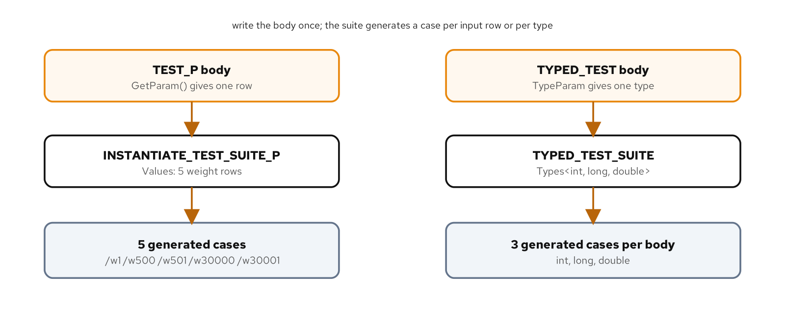

# Parameterized and typed tests

## Learning objectives

By the end of this chapter you can:

- Write a `TEST_P` and instantiate it over a table of inputs with `INSTANTIATE_TEST_SUITE_P`.
- Give each generated case a readable name with a name generator.
- Write a `TYPED_TEST` that runs one body over a list of types.
- Explain the difference between parameterizing on a value and parameterizing on a type.
- Decide when a single parameterized body is clearer than separate cases, and when it is not.

## Diagram



## Why this matters

Part 1 wrote each case by hand, which is right when cases differ in what they check. Part 2 starts where that stops paying off: when several cases run the identical body and differ only in a value or a type. Copying a `TEST` and changing one number gives you cases that drift apart, miss a boundary nobody added, and bury the one line that matters under repetition. GoogleTest has two tools for this. `TEST_P` runs one body over a list of values, and `TYPED_TEST` runs one body over a list of types. You write the body once, and the framework generates a case per entry. The payoff isn't only fewer lines. A table of inputs is a place to see at a glance which cases you cover, so a missing boundary is a visible gap rather than a case nobody wrote, and one body means a fix to the check reaches every input at once.

The code is in `examples/06-parameterized-and-typed/`. The run script there builds and runs it; its `README.md` covers how to drive each lane.

## Parameterizing on a value

The subject is a classifier. `shipping::delivery_band` sorts a parcel into one of three bands by weight:

```cpp
enum class Band : std::uint8_t { Letter, Parcel, Freight };

Band delivery_band(int weight_grams) {
  if (weight_grams <= 0) {
    throw std::invalid_argument("weight_grams must be positive");
  }
  if (weight_grams <= 500) {
    return Band::Letter;
  }
  if (weight_grams <= 30000) {
    return Band::Parcel;
  }
  return Band::Freight;
}
```

The behavior worth testing is the boundaries: the last gram of one band and the first of the next. Written by hand that's five near-identical cases. Parameterized, it's one body and a table.

The five rows aren't arbitrary. Each band has a boundary, 500 grams and 30000 grams, and a classifier's bugs cluster there: an `<` written where `<=` was meant moves a single gram into the wrong band. The table pairs each boundary with the first value past it, so a wrong comparison on either edge turns a row red. Choosing cases this way is boundary-value analysis, and a parameterized table is the natural place to write it down.

### The parameter type and the fixture

Each row needs a weight and the band it should map to, so the parameter is a small struct rather than a bare `int`:

```cpp
struct BandCase {
  int weight_grams;
  shipping::Band expected;
};

class DeliveryBandTest : public ::testing::TestWithParam<BandCase> {};
```

A struct with named fields reads better at the call site than a `std::tuple<int, Band>`, where the test body would reach for `std::get<0>` and leave the reader to remember which element is which. The struct also makes the table legible: `BandCase{500, shipping::Band::Letter}` reads as a weight and its band, where a bare `{500, ...}` tuple row would carry no such labels. The small cost is naming the struct; the payoff is every row and every access reading in domain terms. The fixture derives from `::testing::TestWithParam<BandCase>`, the base that adds one method, `GetParam()`, returning the row for the current run. It's an ordinary fixture otherwise, so it can still hold members and a `SetUp` if the tests need them. When a parameterized fixture does define `SetUp`, `GetParam()` is already available there, so setup can depend on the current row and build a different starting state per input before the body runs.

### The body and the instantiation

`TEST_P`, with a `P` for parameterized, writes the body once against `GetParam()`:

```cpp
TEST_P(DeliveryBandTest, ClassifiesByWeight) {
  const BandCase& row = GetParam();
  EXPECT_EQ(shipping::delivery_band(row.weight_grams), row.expected);
}
```

On its own this body never runs, because nothing has said what the parameters are. `INSTANTIATE_TEST_SUITE_P` supplies them:

```cpp
INSTANTIATE_TEST_SUITE_P(
    Boundaries, DeliveryBandTest,
    ::testing::Values(BandCase{1, shipping::Band::Letter},
                      BandCase{500, shipping::Band::Letter},
                      BandCase{501, shipping::Band::Parcel},
                      BandCase{30000, shipping::Band::Parcel},
                      BandCase{30001, shipping::Band::Freight}),
    [](const ::testing::TestParamInfo<BandCase>& info) {
      return "w" + std::to_string(info.param.weight_grams);
    });
```

The first argument, `Boundaries`, is a name for this instantiation, which lets one `TEST_P` be instantiated more than once with different data. The second names the fixture. The third is the generator: `::testing::Values` lists the rows literally, and GoogleTest runs the body once per row. Other generators cover common shapes without a hand-written list: `ValuesIn` takes a container or array, `Range(0, 100)` walks a numeric range, `Bool()` yields `false` and `true`, and `Combine` takes the cross product of several generators.

The fourth argument is a name generator, and it's worth the few lines. Without it, GoogleTest names each case by index and, for a struct parameter it can't print, appends a raw byte dump. The lambda turns each row into a readable, valid identifier, here `w1`, `w500`, and so on, so a failure names the weight that broke rather than case number three. A generated name has to be a valid C++ identifier, letters, digits, and underscores, which is why the weight is prefixed with `w` rather than left as a bare number.

### Beyond a literal list

`Values` is the simplest generator; a few others cover shapes that would be tedious to spell out. `ValuesIn` takes the rows from an existing array or container, which keeps a long table out of the macro call:

```cpp
constexpr BandCase kRows[] = { /* ...rows... */ };
INSTANTIATE_TEST_SUITE_P(Boundaries, DeliveryBandTest, ::testing::ValuesIn(kRows));
```

`Range(start, stop)` and `Range(start, stop, step)` walk a numeric range, `Bool()` yields `false` and `true`, and `Combine(gen_a, gen_b)` produces the cross product of two generators as a tuple, which exercises every pairing of two independent inputs without nesting loops; `Combine(Range(0, 3), Bool())`, for instance, yields all six pairings of a small index and a flag. The same `TEST_P` body can also be instantiated more than once: a second `INSTANTIATE_TEST_SUITE_P` with a different instantiation name and generator adds another group of cases against the same body, so a fixed table and a generated range can both feed it.

A `TEST_P` with no `INSTANTIATE_TEST_SUITE_P` is a common slip: the body compiles but never runs. Recent GoogleTest turns that silent nothing into a failure, so an uninstantiated suite can't hide behind a green run; when a body is left uninstantiated by design, `GTEST_ALLOW_UNINSTANTIATED_PARAMETERIZED_TEST` says so.

## Parameterizing on a type

Value parameterization reruns a body over data of one type. Type parameterization reruns it over several types, for code that is written to work with any of them. The subject here is a small template:

```cpp
template <typename T>
[[nodiscard]] T clamp_non_negative(T value) {
  return value < T{0} ? T{0} : value;
}
```

It raises a negative measurement to zero and leaves anything else alone, and it should behave the same whether the measurement is an `int` count, a `long`, or a `double`. Testing it against one type would leave the others unproven, and copying the body per type is the duplication this chapter exists to remove. The three types are all signed, which is the point: on an unsigned type the comparison `value < T{0}` can never be true, so clamping would be a no-op and the branch that matters would never run.

### The typed fixture and the type list

A typed test uses a fixture that is itself a template, so GoogleTest can stamp it out once per type:

```cpp
template <typename T>
class ClampNonNegativeTest : public ::testing::Test {};

using ArithmeticTypes = ::testing::Types<int, long, double>;
TYPED_TEST_SUITE(ClampNonNegativeTest, ArithmeticTypes);
```

`::testing::Types<int, long, double>` is the list, and `TYPED_TEST_SUITE` ties the fixture template to it. Inside the bodies, the current type is available as `TypeParam`:

```cpp
TYPED_TEST(ClampNonNegativeTest, LeavesNonNegativeValuesUnchanged) {
  EXPECT_EQ(shipping::clamp_non_negative(TypeParam{7}), TypeParam{7});
}

TYPED_TEST(ClampNonNegativeTest, RaisesNegativeValuesToZero) {
  EXPECT_EQ(shipping::clamp_non_negative(TypeParam{-3}), TypeParam{0});
}
```

Each body is written once and compiled once per type in the list, so a bug that only shows up for `double`, say a comparison that a floating-point value trips, is caught by the same body that passed for `int`. One point of syntax is worth knowing: when a typed test needs a member of its fixture, it has to reach for it through `this->`, because the fixture is a dependent base. While the compiler parses the template, it can't know which members the base will have for a given type, so an unqualified name wouldn't find them; `this->member` defers the lookup to instantiation, when the type is known. These bodies use no fixture members, so they don't need it, but the moment a typed fixture gains state, every access to that state is `this->member`.

Because a typed body is compiled once per type in the list, a type that fails to compile against the code under test fails the build, not just a runtime check. That makes a typed test a compile-time guarantee as much as a runtime one: the body has to be valid, and pass, for every type you list, so adding a type to the list is a quick way to ask whether the code really is as generic as it claims.

There is a third form, covered here only in brief. Type-parameterized tests, written with `TYPED_TEST_P` and registered with `REGISTER_TYPED_TEST_SUITE_P`, let you define a suite of typed tests in one place and apply it to type lists supplied elsewhere, which matters when you ship a concept and want its implementers to reuse your conformance tests. Reach for it when that need appears; the plain `TYPED_TEST` here covers the common case.

> **AI sidebar.** Give an assistant a function with many cases and it will sometimes parameterize cleanly and sometimes paste a dozen near-identical `TEST`s; asked to parameterize, it may force cases with different assertions into one body with a branch keyed on the parameter. Check that a parameterized body is identical across rows, with only the data changing, and that a typed test's type list includes the types that actually behave differently, not just the one the code was written against. A branch inside a `TEST_P` body that switches on the parameter is the tell that two tests were merged into one.

## Build, run, observe

Run the default lane:

```bash
[host]$ cd examples/06-parameterized-and-typed
[host]$ ./demo.sh test
```

```console
100% tests passed, 0 tests failed out of 11
```

Eleven cases from four bodies: five from the parameterized table, and six from the two typed bodies across three types. The count makes the expansion visible: four bodies in the source become eleven cases in the run, and the run total is a quick measure of how much those bodies actually exercise, with no eleven copied cases to keep in step. The suite also passes under `./demo.sh asan` and `./demo.sh tsan`.

When a parameterized case fails, the report leads with its full name, the instantiation, the fixture, the body, and the row, so `Boundaries/DeliveryBandTest.ClassifiesByWeight/w500` names the failing row before you read the assertion. That's the real reason the name generator is worth the lines: the name carries the input, so a red boundary tells you which gram broke without opening the table.

## Cross-check

Listing the cases shows how the two mechanisms name what they generate:

```console
[host]$ ./build/unit_tests --gtest_list_tests
ClampNonNegativeTest/0.    # TypeParam = int
  LeavesNonNegativeValuesUnchanged
  RaisesNegativeValuesToZero
ClampNonNegativeTest/1.    # TypeParam = long
  ...
Boundaries/DeliveryBandTest.
  ClassifiesByWeight/w1
  ClassifiesByWeight/w500
  ClassifiesByWeight/w501
  ClassifiesByWeight/w30000
  ClassifiesByWeight/w30001
```

The typed suite names its instances `/0`, `/1`, `/2` and annotates each with the type it stands for. The parameterized suite uses the names the generator produced, so a failing boundary reads as `ClassifiesByWeight/w500` rather than an index. Each generated name can be fed back to `--gtest_filter`, so `--gtest_filter='*/w500'` reruns just that row while you fix it. The instantiation name is the leading segment, so `--gtest_filter='Boundaries/*'` runs the whole parameterized group and `--gtest_filter='ClampNonNegativeTest/*'` runs every typed instance; that prefix is also how two instantiations of one body stay distinct in the report.

## When to reach for each, and when not to

Parameterize on a value when several cases run the same body and differ only in data, like the band boundaries. Parameterize on a type when one piece of generic code must hold for several types. Both pay for themselves by removing copies that would otherwise drift.

The failure mode is parameterizing things that aren't really the same test. If two cases need different assertions, or one checks a value and another checks that a call throws, forcing them into one parameterized body with a branch inside it is harder to read than two plain `TEST` cases. A good tell is a conditional in the body that keys on the parameter: when the body says `if (param == X) EXPECT_...; else EXPECT_...`, it's two tests wearing one coat, and splitting them lets each one state exactly what it checks. The question to ask is whether the body stays identical and only the data or the type changes. When it does, parameterize; when the body itself has to change per case, write separate cases.

## What you learned

- `TEST_P` runs one body over a list of values; a `TestWithParam<T>` fixture exposes the current value through `GetParam()`, and `INSTANTIATE_TEST_SUITE_P` supplies the values.
- A struct parameter reads better than a tuple, and a name generator turns generated cases into readable, filterable names.
- `TYPED_TEST` runs one body over a `::testing::Types<...>` list, with the current type as `TypeParam`; a typed fixture reaches its own members through `this->`.
- Parameterize only when the body is identical and just the data or type changes; otherwise separate cases are clearer.

The next chapter turns to failure paths: death tests, exceptions, and asserting on a `std::expected`.

## For deeper coverage

- The [GoogleTest advanced guide](https://google.github.io/googletest/advanced.html): value-parameterized tests, the generator functions, and typed and type-parameterized tests.
- The [GoogleTest reference on testing::Types and generators](https://google.github.io/googletest/reference/testing.html): `Values`, `ValuesIn`, `Range`, `Combine`, and the typed-test macros.
- *The Art of Software Testing* by Glenford Myers, Tom Badgett, and Corey Sandler ([Wiley](https://www.wiley.com/en-us/The+Art+of+Software+Testing%2C+3rd+Edition-p-9781118031964)): boundary-value analysis, which is what the parameterized table encodes.
- The full reading list lives on the bibliography page.

---

*Verification status: verified. On Fedora 44 (Clang 22.1.8, CMake 4.3.0, Conan 2.33.0, GoogleTest 1.18.0), `examples/06-parameterized-and-typed` builds and reports 11/11 on `./demo.sh test`, `asan`, and `tsan`; `--gtest_list_tests` shows the generated names quoted above. Re-run all lanes before a release.*
