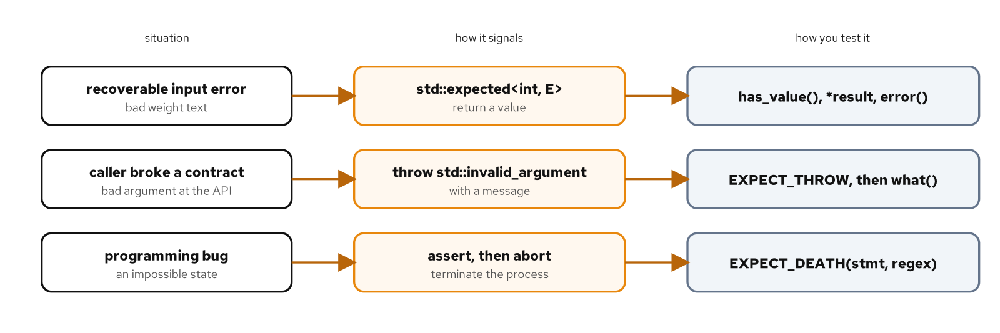
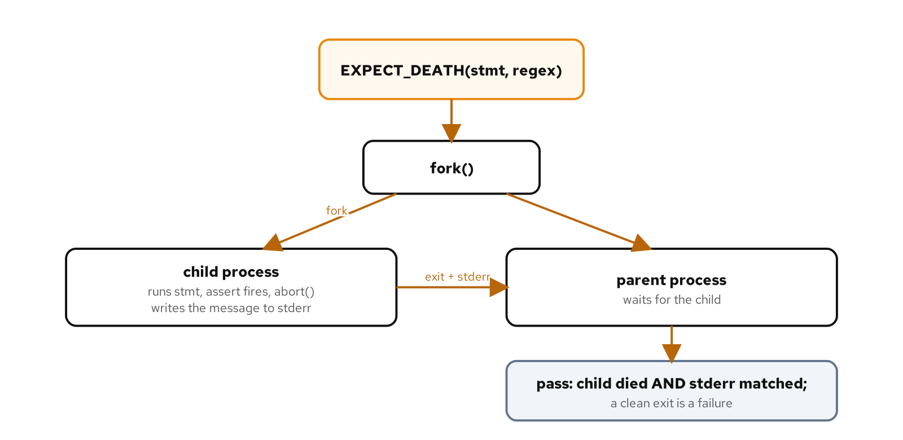

# Death tests, exceptions, and std::expected

## Learning objectives

By the end of this chapter you can:

- Match a failure to the right mechanism: a value for a recoverable error, an exception for a broken contract, an abort for a programming bug.
- Test a `std::expected` result by checking `has_value()`, the value, and the error.
- Assert on a thrown exception's type and its message, not just that something threw.
- Write an `EXPECT_DEATH` test and explain how it forks a child process to do its work.
- Name the sanitizer and threading caveats that make a death test behave differently from an ordinary one.

## Diagram



## Why this matters

The tests so far checked what code does when it works. Code that only works on the happy path is half-tested, and the failure paths are where the subtle bugs live: the error that is swallowed, the exception that carries no useful message, the invariant that is assumed but never enforced. C++ gives you three ways to signal a failure, and they are not interchangeable. A recoverable error a caller should handle is a return value. A violated contract, a bad argument crossing an API boundary, is an exception. A bug that should be impossible is an abort, loud and immediate. This chapter tests one of each, and the first job is choosing the right one, because a test can only be as sound as the failure design underneath it. That choice isn't cosmetic. It decides whether a caller is forced to handle an error or free to ignore it, whether a failure stops one operation or the whole process, and, downstream, how you test it. Get the mechanism wrong and the test fights you; get it right and the test nearly writes itself.

The code is in `examples/07-failure-paths/`. The run script there builds and runs it; its `README.md` covers how to drive each lane.

## How the code works

### A recoverable error is a value: std::expected

Parsing a weight from text can fail for reasons a caller can reasonably handle: the text is empty, it is not a number, or it is not positive. None of these is exceptional, so `parse_weight` returns the outcome as a value, using C++23's `std::expected`:

```cpp
enum class ParseError : std::uint8_t { Empty, NotANumber, NotPositive };

std::expected<int, ParseError> parse_weight(std::string_view text) {
  if (text.empty()) {
    return std::unexpected(ParseError::Empty);
  }
  int value = 0;
  const char* const end = text.data() + text.size();
  const auto [ptr, ec] = std::from_chars(text.data(), end, value);
  if (ec != std::errc{} || ptr != end) {
    return std::unexpected(ParseError::NotANumber);
  }
  if (value <= 0) {
    return std::unexpected(ParseError::NotPositive);
  }
  return value;
}
```

A `std::expected<int, ParseError>` holds either an `int` or a `ParseError`, never both and never neither. On success the function returns the `int` directly, and the implicit conversion wraps it as the expected value. On failure it returns `std::unexpected(...)`, the wrapper that marks the other alternative. The parse itself uses `std::from_chars`, which reports failure through an error code rather than an exception and never allocates, and the `ptr != end` check rejects trailing garbage so `"12kg"` is `NotANumber` rather than a silent `12`.

`std::from_chars` is the right parsing primitive here for reasons that matter to a test. It doesn't throw, so the function stays in the value-returning style without a `try` inside it. It doesn't allocate or consult the locale, so its behavior is identical on every machine the test runs on. And it reports exactly how far it got through `ptr`, which is what makes the trailing-garbage rejection possible. `std::stoi` would throw on bad input and quietly accept a trailing suffix, and `strtol` reports errors through `errno`, both of which are harder to fold into a clean `expected`.

Testing a result type means checking both halves. First that the discriminator is what you expect, then the payload behind it:

```cpp
TEST(ParseWeight, ReturnsGramsForValidText) {
  const std::expected<int, shipping::ParseError> result =
      shipping::parse_weight("2500");
  ASSERT_TRUE(result.has_value());
  EXPECT_EQ(*result, 2500);
}
```

The `has_value()` check is an `ASSERT`, not an `EXPECT`, for the reason from the previous chapter: `*result` reads the value, and dereferencing an expected that holds an error is undefined, so the test must stop if the result came back empty. The failure cases check the other alternative through `error()`:

```cpp
TEST(ParseWeight, RejectsNonNumericText) {
  EXPECT_EQ(shipping::parse_weight("12kg").error(),
            shipping::ParseError::NotANumber);
}
```

Each rejection names the specific `ParseError` it expects, so a test fails if the function rejects the text for the wrong reason, not only if it wrongly accepts it. A test that merely checked `has_value()` was false would pass whether the parser reported `NotANumber` or `NotPositive`, and would miss a classifier that put the right inputs in the wrong buckets.

`std::expected` is more than a tagged union. It carries monadic operations that let a caller chain work without unwrapping at every step: `and_then` runs a function returning another `expected` only on success, `transform` maps the held value and leaves an error untouched, `or_else` handles the error, and `value_or(fallback)` collapses the whole thing to a plain value with a default. A test can lean on `value_or` to state an expectation compactly, as in `EXPECT_EQ(parse_weight("x").value_or(-1), -1)`, which reads as "a bad parse yields the fallback" without a separate `has_value` check. The deeper point for testing is that the type makes the error impossible to ignore: a caller can't reach the `int` without passing through the discriminator, so an untested error path shows up as a visible gap rather than a silent one.

The error type is a design choice of its own. Here it's a small `enum class`, which is enough to say why a parse failed and cheap to compare in a test with `EXPECT_EQ`. A richer domain might use a struct carrying a code and some context, or a dedicated error-category type; `std::expected` places no requirement on `E` beyond its being a usable type. For a test, an enum has the nice property that the set of failure reasons is closed and visible, so a reviewer can tell at a glance whether every reason has a case covering it.

### A broken contract is an exception

Some callers would rather not branch on a result type, so `parse_weight_or_throw` offers the same parse behind an exception, translating each `ParseError` into a message:

```cpp
int parse_weight_or_throw(std::string_view text) {
  const std::expected<int, ParseError> result = parse_weight(text);
  if (result) {
    return *result;
  }
  switch (result.error()) {
    case ParseError::Empty:
      throw std::invalid_argument("weight text is empty");
    case ParseError::NotANumber:
      throw std::invalid_argument("weight text is not a number");
    case ParseError::NotPositive:
      throw std::invalid_argument("weight must be positive");
  }
  throw std::invalid_argument("unknown parse error");  // unreachable
}
```

The throwing variant doesn't re-parse. It calls `parse_weight` and translates the error into a message, so the parsing rules live in exactly one place and the two entry points can never disagree about what counts as valid. Testing both is still worthwhile, because the error-to-message translation is its own logic, but neither test has to re-cover the parsing rules the other already pins down.

Chapter 4 used `EXPECT_THROW` to check that a call throws a given type. That's often enough, but it checks only the type, not the message, and a function that throws the right exception with the wrong text is still wrong. To assert on the message, catch the exception yourself:

```cpp
TEST(ParseWeightOrThrow, ThrowsWithAMessageNamingTheReason) {
  try {
    (void)shipping::parse_weight_or_throw("");
    FAIL() << "expected parse_weight_or_throw to throw";
  } catch (const std::invalid_argument& error) {
    EXPECT_STREQ(error.what(), "weight text is empty");
  }
}
```

The shape matters. The `FAIL()` after the call is reached only if the call did not throw, which turns a missing exception into a clear failure instead of a silently passing test. The `catch` then inspects `what()` with `EXPECT_STREQ`, the C-string comparison from Chapter 4, since `what()` returns a `const char*`. GoogleMock adds a tidier one-liner for this, `EXPECT_THAT(expr, ThrowsMessage<std::invalid_argument>(HasSubstr("empty")))`, which the mocking chapters cover; the try-and-catch form here needs nothing beyond GoogleTest and shows exactly what the matcher does under the surface.

Asserting on the message pays off only when the message carries something worth pinning. A good `what()` names what was wrong in terms the caller can act on, "weight must be positive" rather than "bad input". A test that pins the exact text pins that contract too, so a later edit that degrades the message into something vague fails the test. Keep the asserted text to the stable, meaningful part: pinning an incidental detail like a file path or a number that might change makes the test brittle for no gain.

### A programming bug aborts: death tests

The third kind of failure is the one that should never happen. `remaining_capacity` subtracts used weight from a truck's total, and a caller passing more used than total is not a recoverable error or a bad external input; it is a bug in the calling code. The function guards the invariant with `assert`:

```cpp
int remaining_capacity(int total_grams, int used_grams) {
  assert(used_grams <= total_grams && "used must not exceed total");
  return total_grams - used_grams;
}
```

A failed `assert` calls `abort`, which terminates the process. You can't test that with `EXPECT_THROW`, because nothing is thrown, and you can't let it run in the test process, because it would take the whole test binary down with it. A death test solves both: it runs the statement in a separate process and checks that the process died the way you expected.



```cpp
TEST(RemainingCapacityDeathTest, AbortsWhenUsedExceedsTotal) {
  EXPECT_DEATH((void)shipping::remaining_capacity(5, 10),
               "used must not exceed total");
}
```

`EXPECT_DEATH(statement, regex)` forks a child process, runs the statement in it, and expects the child to terminate abnormally. The second argument is a regular expression matched against the child's standard error, so the test confirms not just that the process died but that it died for the stated reason: the assert message `used must not exceed total` appears in the output. Figure 7.2 traces the sequence. If the statement returns normally instead of dying, the child exits cleanly, and the test fails, because a precondition that was supposed to be unviolable just held with a broken input.

The second argument is a regular expression, not a literal, and GoogleTest searches for it anywhere in the child's stderr. A short, stable fragment of the message is a better pattern than the whole line: it survives a reworded assert and ignores the extra output a sanitizer or the runtime may print around the crash. Special characters in the pattern, parentheses or a dot, need escaping, which is another reason to match a plain substring like `used must not exceed total` rather than the full formatted assertion.

Like the other assertions, death tests come in a fatal `ASSERT_DEATH` and a non-fatal `EXPECT_DEATH`, chosen by whether the rest of the test can continue after the statement failed to die. A related macro, `EXPECT_EXIT`, checks both that the process exited and that its exit code satisfies a predicate. You reach for it when the code calls `std::exit` with a specific status rather than aborting; `EXPECT_DEATH` is effectively `EXPECT_EXIT` with a predicate that accepts any abnormal termination.

Three things about death tests are worth carrying forward. They're slower than ordinary tests, because each one forks a process; a death test that runs in tens of milliseconds sits beside ordinary tests that run in microseconds. By convention the suite is named with a `DeathTest` suffix, `RemainingCapacityDeathTest` here, which GoogleTest recognizes and runs before other suites, a small ordering safeguard. And the fork is where the caveats live: the default "fast" style forks without re-running the binary, which is fine for the single-threaded code here. A program that has already started threads should set the "threadsafe" style, because forking a multithreaded process and then doing real work in the child is unsafe. The threadsafe style trades speed for safety: rather than forking and continuing, it re-executes the test binary from the start in the child and runs only the one death test there, which avoids inheriting a half-forked lock state at the cost of a slower run. You select it per run with the `--gtest_death_test_style=threadsafe` flag, or in code for a single test. Under ThreadSanitizer the same caution applies, and GoogleTest will warn when it cannot tell how many threads are running. This example is single-threaded, so it passes on every lane as written, abort included.

> **AI sidebar.** Ask an assistant to "add error handling and tests" and it reaches for exceptions and `EXPECT_THROW` by reflex, because that is the shape most C++ tutorials show. It rarely proposes `std::expected` for a recoverable error, almost never writes a death test for an invariant, and when it does test a throw it usually checks the type and stops, leaving the message unasserted. Read the generated tests against the three rows of Figure 7.1 before accepting them. Ask whether a failure the model turned into an exception is really a recoverable outcome that a `std::expected` value would model better, whether the thrown message is actually checked, and whether any `assert` or "this can't happen" comment in the code has a death test behind it. A generated suite that exercises only the happy path and one exception type is the common tell that the failure paths went untested.

## Build, run, observe

Run the default lane:

```bash
[host]$ cd examples/07-failure-paths
[host]$ ./demo.sh test
```

```console
100% tests passed, 0 tests failed out of 8
```

Eight cases: four on the `std::expected` parser, two on the throwing variant, and two on the invariant, one of which is the death test. Running the death suite alone shows it pass, and shows the fork cost in the timing:

```console
[host]$ ./build/unit_tests --gtest_filter='*DeathTest*'
[ RUN      ] RemainingCapacityDeathTest.AbortsWhenUsedExceedsTotal
[       OK ] RemainingCapacityDeathTest.AbortsWhenUsedExceedsTotal (89 ms)
[  PASSED  ] 1 test.
```

The 89 milliseconds, against microseconds for the value-based tests, is the fork and the child's run. The suite also passes under `./demo.sh asan` and `./demo.sh tsan`, death test included, because the aborting code never started a thread.

## Cross-check

Listing the cases shows the death suite first, the ordering the `DeathTest` suffix buys:

```console
[host]$ ./build/unit_tests --gtest_list_tests
RemainingCapacityDeathTest.
  AbortsWhenUsedExceedsTotal
ParseWeight.
  ReturnsGramsForValidText
  RejectsEmptyTextWithEmptyError
  RejectsNonNumericText
  RejectsNonPositiveText
ParseWeightOrThrow.
  ReturnsGramsForValidText
  ThrowsWithAMessageNamingTheReason
RemainingCapacity.
  ReturnsTheDifferenceWhenValid
```

The four suites match the source: the death suite, the two parser suites, and the ordinary capacity suite, eight cases in all.

## Choosing the mechanism

The test you write follows from the failure you designed, so the real decision is upstream. Return a `std::expected` when the caller can reasonably recover and the error is part of normal operation, like parsing external input; the type forces the caller to acknowledge the error before using the value. Throw when a contract is broken at an API boundary and the immediate caller can't sensibly continue, and give the exception a message that names what was wrong. Reserve `assert` and the death test for states that should be impossible if the surrounding code is correct, where continuing would be worse than stopping. The cost reinforces that split: forking per case makes death tests far slower than ordinary ones, so a suite full of them drags, and the forked child inherits the whole process, which is the threading caveat again. Keep them for the invariants that warrant one, and prefer a value or an exception wherever the failure is something a caller should handle rather than a reason to end the program. Match the test to that choice: `has_value`/`error` for a result, a caught exception for a throw, `EXPECT_DEATH` for an abort. A failure modelled the wrong way, an exception for a routine rejection or a silent error code for a real bug, produces a test that's awkward to write, which is usually the first sign the design should change, not the test.

## What you learned

- A recoverable error returns as a `std::expected` value; test both the discriminator with `has_value()` and the payload with `*result` or `error()`, and `ASSERT` the discriminator before reading the value.
- `EXPECT_THROW` checks only the exception type; catch the exception and inspect `what()`, with a `FAIL()` after the call, to assert on the message.
- `EXPECT_DEATH` forks a child, runs the statement, and passes only if the child dies and its stderr matches the regex; a clean exit is a failure.
- Death tests are slower (they fork), run first by the `DeathTest` suffix convention, and need the threadsafe style once threads are involved.

The next chapter tests modern C++20 and C++23 features directly: concepts, ranges, and coroutines under test.

## For deeper coverage

- The [GoogleTest reference on death tests](https://google.github.io/googletest/reference/death.html): `EXPECT_DEATH`, the death-test styles, and the threading caveats.
- The [GoogleTest advanced guide](https://google.github.io/googletest/advanced.html): exception assertions and the death-test discipline.
- [cppreference on `std::expected`](https://en.cppreference.com/w/cpp/utility/expected): the value-or-error type and `std::unexpected`.
- The full reading list lives on the bibliography page.

---

*Verification status: verified. On Fedora 44 (Clang 22.1.8, CMake 4.3.0, Conan 2.33.0, GoogleTest 1.18.0), `examples/07-failure-paths` builds and reports 8/8 on `./demo.sh test`, `asan`, and `tsan`, the death test included; the death-test output and `--gtest_list_tests` listing are quoted from real runs. Re-run all lanes before a release.*
