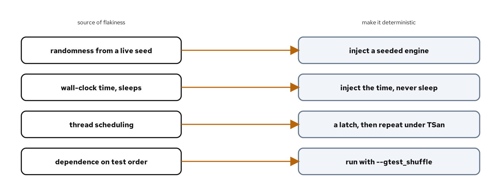
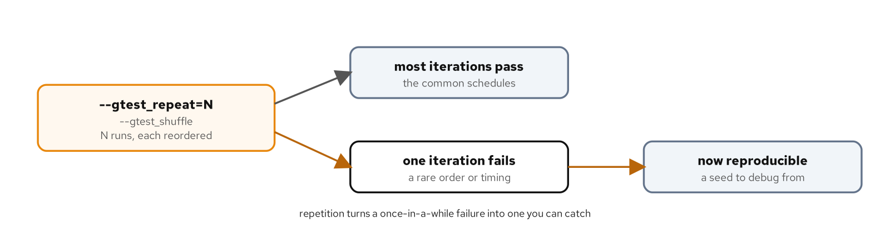

# Deterministic and stress testing

## Learning objectives

By the end of this chapter you can:

- Name the common sources of a flaky test and the determinism technique that removes each.
- Inject the current time into a unit so a test chooses the moment instead of sleeping.
- Inject a seeded random engine so a randomized unit produces a reproducible result.
- Stress a suite with `--gtest_repeat` and `--gtest_shuffle` to surface order and timing dependence.
- Triage a flaky test: reproduce it, fix the cause, and quarantine it only as a last resort.

## Diagram



## Why this matters

A flaky test is one that passes and fails on the same code, and it's worse than a test that always fails. A consistent failure gets fixed; a flaky one gets rerun until it is green and then ignored, and over time a suite full of flaky tests trains everyone to disbelieve it. The previous two chapters met the most common cause, a data race, and the tools that catch it. This chapter is about the rest: the tests that wobble because they depend on something the test does not control, most often the clock, a random seed, or the order the tests happen to run in.

The cure is almost always the same shape. Find the uncontrolled input and pass it in. A unit that reads the system clock is hard to test without waiting; a unit that takes the time as an argument is trivial. A function that seeds its own random engine gives a different answer every run; one that takes the engine lets the test seed it and pin the answer. Figure 13.1 pairs each common source with its fix. Once the inputs are controlled, a second tool helps with what remains: running the suite many times, in shuffled order, to turn a rare failure into a repeatable one. This chapter builds two units the controlled way and then stresses the suite to show it holds.

The code is in `examples/13-deterministic-and-stress/`. The run script there builds and runs it; its `README.md` covers how to drive each lane.

## How the code works

### Injecting time instead of sleeping

`QuoteCache` holds a quote that is valid for a time-to-live. The temptation is to have it read `std::chrono::steady_clock::now()` internally, but then a test of staleness would have to sleep for the TTL to elapse, which is slow and itself flaky. Instead, freshness is decided against a time the caller passes in:

```cpp
std::optional<int> QuoteCache::get(TimePoint now) const {
  if (!has_value_ || now - stored_at_ >= ttl_) {
    return std::nullopt;
  }
  return cents_;
}
```

The class never reads a clock. `store` records the time it was told, and `get` compares it against the `now` the caller supplies. In production the caller passes `steady_clock::now()`; in a test the caller passes whatever moment it wants to test, and no time actually passes:

```cpp
TEST(QuoteCache, FreshWithinTheTtlAndStaleAfter) {
  QuoteCache cache(60s);
  const QuoteCache::TimePoint start{};
  cache.store(1500, start);

  EXPECT_EQ(cache.get(start + 59s), 1500);          // inside the TTL
  EXPECT_EQ(cache.get(start + 61s), std::nullopt);  // past the TTL
}
```

The test moves time by arithmetic, not by waiting, so it runs in microseconds and gives the same answer every run. The boundary case is its own test: at exactly the TTL the quote is stale, because the comparison is `>=`. A version that read the clock internally could not test this at all without sleeping sixty seconds and hoping the scheduler cooperated.

Passing the time as a parameter is the simplest seam, and it fits a unit whose methods already take arguments. A longer-lived component that reads the time in many places is better served by a clock it holds: an interface with a `now()` that the production build backs with the system clock and the test backs with one it advances by hand. Both are the same idea, moving the clock read to a point the test controls. The parameter suits a free function or a single method; the injected clock suits a class that consults the time across several operations and wants them all to see the same test-controlled value.

### Injecting the random engine

`choose_backup_carrier` picks a carrier at random, which sounds untestable until the randomness is injected. The engine is a parameter, not a member:

```cpp
std::string choose_backup_carrier(std::span<const std::string> candidates,
                                  std::mt19937& engine) {
  std::uniform_int_distribution<std::size_t> pick(0, candidates.size() - 1);
  return candidates[pick(engine)];
}
```

Because the caller owns the engine, a test seeds it with a constant and gets the same choice every time:

```cpp
TEST(ChooseBackupCarrier, PicksTheExpectedCandidateForSeed12345) {
  const std::vector<std::string> candidates{"north", "south", "east", "west"};
  std::mt19937 engine(12345);
  EXPECT_EQ(shipping::choose_backup_carrier(candidates, engine), "west");
}
```

A fixed seed makes `std::mt19937` a deterministic sequence, so seed 12345 always leads to `"west"`. That exact-value assertion is only possible because the seed is pinned; with a live seed the most a test could check is that the result is one of the candidates, which is a far weaker statement. A companion test seeds two engines identically and confirms they make the same choice, which states the reproducibility directly. Production seeds from `std::random_device`, a nondeterministic source; the seam is what lets the test swap in a constant.

One caveat on reproducibility: the engine is portable but the distribution isn't. `std::mt19937` produces the same sequence of raw values on every standard library, but `std::uniform_int_distribution` may map those values to a range differently across implementations, so an exact-pick assertion can hold on one compiler and differ on another. Within a single toolchain it is stable, which is enough here. A suite that must agree across compilers should map the raw engine output to its range itself rather than lean on the distribution, trading a little code for portability.

One note from the build: clang-tidy's `bugprone-random-generator-seed` flags seeding an engine with a constant, because in production that is usually a mistake. In a deterministic test it is the whole point, so the example disables that check for test code only, in a `tests/.clang-tidy`, while leaving it active for the library under `src/`. The warning is right about production and wrong about tests, and scoping the exception keeps both true.

### Stressing the suite

Controlling the inputs removes the flakiness you can name. Repetition finds the flakiness you cannot. GoogleTest can run the whole suite many times and shuffle the order each time:

```bash
[host]$ ./build/unit_tests --gtest_repeat=500 --gtest_shuffle
```

`--gtest_repeat=500` runs every test five hundred times, and `--gtest_shuffle` randomizes the order on each iteration, printing the seed it used so a failing order can be replayed. The two together attack two different flakiness causes: repetition gives a rare interleaving or timing window many chances to appear, and shuffling exposes any test that only passes because an earlier test left some global state behind. A suite that stays green through this is far more trustworthy than one that passed once in declaration order.

Shuffling targets that second bug specifically: a test that passes only because an earlier one populated a static singleton, wrote a file, or set an environment variable. Such a test is green in declaration order and red when the order changes, so a shuffled run is the one that catches it. The fix is isolation, each test setting up what it needs and leaving nothing behind, which the fixtures from the earlier chapter make straightforward. Where the stress run belongs depends on its cost: a fast suite can take `--gtest_repeat` on every commit, while a slow or heavily threaded one is better repeated in a nightly job that has time for hundreds of iterations. Either way, the seed printed on a failing iteration is the thing to capture, because it's what turns "it failed once in CI" into a local reproduction. The replay is explicit: `--gtest_random_seed=N` runs the suite in the exact order that seed produces, so a failure found deep in a shuffled run can be reproduced on its own. That logged, repeatable randomization is what makes `--gtest_shuffle` safe to depend on rather than a black box that fails and forgets how.

> **AI sidebar.** Asked to fix a flaky test, an assistant's first instinct is often to paper over it: add a `sleep` to "let things settle," wrap it in a retry, or loosen the assertion until it stops failing. Each hides the flake instead of removing it, and the sleep makes the suite slower and no more reliable. Steer toward the cause: ask what uncontrolled input the test depends on, and whether the fix injects a clock or a seed rather than waiting or retrying. When a model suggests seeding a generator, check that the seam is the injection, a seed or an engine passed in, not a constant buried inside the unit, which would make production deterministic too. And when it proposes a retry wrapper, ask what the retry is hiding, because a test that needs three attempts to pass is reporting a real bug in the code or in itself.

## Build, run, observe

Run the default lane:

```bash
[host]$ cd examples/13-deterministic-and-stress
[host]$ ./demo.sh test
```

```console
100% tests passed, 0 tests failed out of 6
```

The six tests cover the cache and the carrier choice, all deterministic. The stress run repeats and shuffles them, and stays green through every iteration:

```console
[host]$ ./build/unit_tests --gtest_repeat=3 --gtest_shuffle
Repeating all tests (iteration 1) . . .
Note: Randomizing tests' orders with a seed of 69383 .
[  PASSED  ] 3 tests.
Repeating all tests (iteration 2) . . .
Note: Randomizing tests' orders with a seed of 69384 .
[  PASSED  ] 3 tests.
```



Five hundred shuffled iterations pass the same way. That stability is the evidence the inputs are controlled: a test that still depended on the clock, a live seed, or run order would eventually trip over one of the five hundred shuffles. Figure 13.2 shows what the same run would do to a flaky suite, surfacing the bad iteration with a seed you can replay.

## See it fail

To show what the fixed seed buys, reseed the exact-pick test from `std::random_device` instead of the constant, so it draws a real random choice each run. The exact-value assertion then holds only when the draw happens to land on `"west"`:

```console
run 1: FAILED
run 2: FAILED
run 5: passed
run 9: passed
run 10: FAILED
```

Across ten runs it failed on most and passed on a couple, which is a flaky test in miniature: same code, different result, roughly a one-in-four pass rate matching the four candidates. This is the exact failure mode the constant seed removes. It also shows why a flaky test is dangerous, because a developer who saw run 5 pass might conclude the test is fine, when it's only the draw that changed. Pinning the seed makes the result a property of the code, not of chance.

## Handling a flake you cannot fix yet

Sometimes a flake outlives the time you have to fix it. The order of preference is clear. Fix the cause by injecting the uncontrolled input, which is almost always possible and is the technique this chapter demonstrates. If the cause is external and slow to address, quarantine the test by disabling it with a `DISABLED_` prefix on its name, which keeps it compiled and visible without failing the build, and file the work to fix it. Reserve retries for the last resort, because a retry hides the signal: a test that passes on the second attempt still failed on the first, and that failure was telling you something. A quarantined test is visibly broken; a silently retried one looks fine while it isn't. Noticing a flake in the first place is its own practice: a CI system that tracks each test's pass rate over time can flag one that fails intermittently, even when a rerun turns the build green, which is how a flake gets caught before the team quietly learns to rerun it.

## Cross-check

Listing the cases shows the six deterministic tests across the two suites:

```console
[host]$ ./build/unit_tests --gtest_list_tests
QuoteCache.
  FreshWithinTheTtlAndStaleAfter
  ExactlyAtTheTtlIsStale
  ReturnsNulloptBeforeAnythingIsStored
ChooseBackupCarrier.
  IsReproducibleForAFixedSeed
  PicksTheExpectedCandidateForSeed12345
  AlwaysReturnsOneOfTheCandidates
```

The two reproducibility tests are the ones this chapter turns on: one asserts the exact pick for a seed, the other asserts two identical seeds agree.

## What you learned

- A flaky test depends on something it does not control, usually the clock, a random seed, or test order; the fix is to inject that input.
- Pass the current time into a unit so a test chooses the moment with arithmetic instead of sleeping for a TTL.
- Pass a random engine into a unit so a test seeds it and asserts an exact result; production seeds from `std::random_device`.
- `--gtest_repeat` with `--gtest_shuffle` stresses a suite across many runs and orders, turning a rare failure into a reproducible one with a replayable seed.
- Fix a flake at its cause; quarantine with `DISABLED_` only as a stopgap, and avoid retries, which hide the signal.

This chapter closes Part 4. The next part turns to tooling and workflow: debugging a failing test under GDB, measuring coverage with llvm-cov, and running the whole suite reproducibly in CI.

## For deeper coverage

- The [GoogleTest advanced guide](https://google.github.io/googletest/advanced.html): `--gtest_repeat`, `--gtest_shuffle`, and disabling tests.
- [cppreference on `std::mt19937`](https://en.cppreference.com/w/cpp/numeric/random/mersenne_twister_engine): the engine, its seeding, and its deterministic sequence.
- [cppreference on `<chrono>`](https://en.cppreference.com/w/cpp/chrono): clocks, time points, and durations.
- The full reading list lives on the bibliography page.

---

*Verification status: verified. On Fedora 44 (Clang 22.1.8, CMake 4.3.0, Conan 2.33.0, GoogleTest 1.18.0), `examples/13-deterministic-and-stress` builds and reports 6/6 on `./demo.sh test`, `asan`, and `tsan`, and stays green under `--gtest_repeat=500 --gtest_shuffle`; the stress output and the flaky-run sample are quoted from real runs with host paths removed. Re-run all lanes before a release.*
