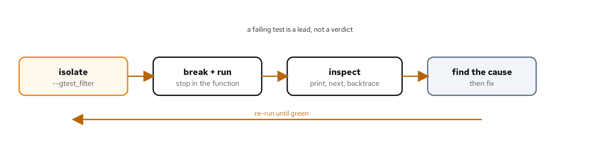
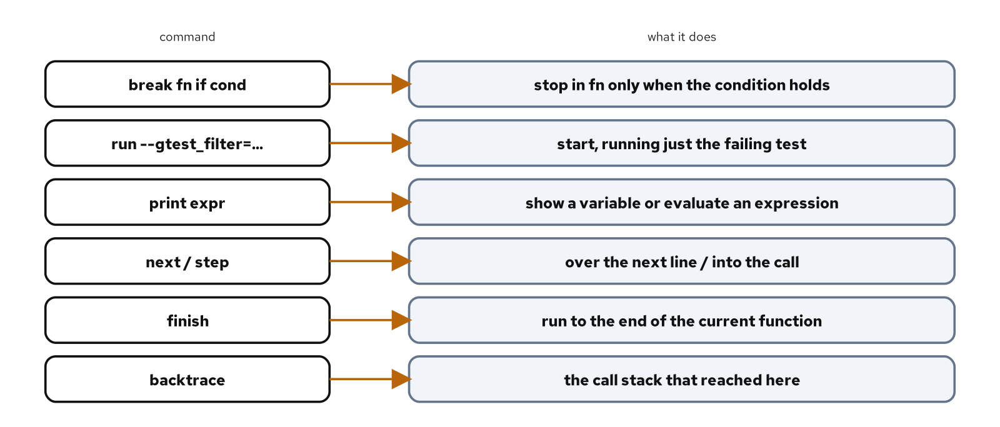

# Debugging a failing test with GDB

## Learning objectives

By the end of this chapter you can:

- Launch a GoogleTest binary under GDB and run a single failing case with a filter.
- Set a breakpoint on a function, including a conditional one that stops on a specific input.
- Inspect state with `print`, move with `next`, `step`, and `finish`, and read the call stack with `backtrace`.
- Follow a failing assertion from the test body down into the function that produced the wrong value.
- Work the debug loop: isolate, stop, inspect, find the cause, fix, and re-run.

## Diagram



## Why this matters

A failing test tells you something is wrong and, if its name and message are good, roughly what. It doesn't tell you why. For a simple assertion the message is often enough, but for a wrong value deep in a function, or a crash with no clear cause, you need to see the program as it runs: the arguments it was called with, the branch it took, the stack that led there. That is what a debugger gives you, and GDB is the one on this toolchain.

A GoogleTest binary is an ordinary program, so it runs under GDB like any other, with two conveniences that make it pleasant. The `--gtest_filter` flag runs only the failing case, so you aren't stepping through a hundred passing tests to reach the one that broke. And because the suite is built with debug symbols, GDB can show source lines, name variables, and set breakpoints by function name. This chapter takes a small tiered-rate function, plants a boundary bug in it, and walks the debug loop in Figure 14.1 from the red test to the fixed one. The function is small so the focus stays on the tool, but the moves are the same on code that is not. A debugger is not the first thing to reach for on every failure: when the assertion message already names the wrong value and the function is short, reading the code is faster. The debugger earns its time when the state is large, the path to the failure is long, or the failure is a crash with no message, which are the cases where guessing from the source is slow and watching the program run is quick.

The code is in `examples/14-debugging/`. The run script there builds and runs it; its `README.md` covers how to drive each lane, and the debugging commands below.

## How the code works

### The function and its boundary tests

`tiered_cost_cents` charges a shipping rate by weight tier, and the tiers meet at boundaries that are the natural place for a bug:

```cpp
int tiered_cost_cents(int weight_grams) {
  if (weight_grams <= 500) {
    return 500;
  }
  if (weight_grams <= 2000) {
    return 1200;
  }
  if (weight_grams <= 5000) {
    return 2500;
  }
  return 4000;
}
```

The test checks every boundary: the heaviest weight that still falls in a tier and the lightest that spills into the next. That pairing is what pins the comparison operators, because `<= 2000` and `< 2000` agree everywhere except at exactly 2000:

```cpp
TEST(TieredCost, ChargesByWeightTier) {
  EXPECT_EQ(shipping::tiered_cost_cents(500), 500);    // top of tier 1
  EXPECT_EQ(shipping::tiered_cost_cents(501), 1200);   // bottom of tier 2
  EXPECT_EQ(shipping::tiered_cost_cents(2000), 1200);  // top of tier 2
  EXPECT_EQ(shipping::tiered_cost_cents(2001), 2500);  // bottom of tier 3
  // ...
}
```

Now suppose the middle tier is written `weight_grams < 2000` by mistake. Five of the six cases still pass; only the boundary at 2000 fails, because a 2000-gram parcel now falls past the second tier into the third:

```console
rates_test.cpp:15: Failure
Expected equality of these values:
  shipping::tiered_cost_cents(2000)
    Which is: 2500
```

The message says the value is wrong and names the input, 2000, that produced it. That's the lead. GDB turns it into the cause.

### Launching under GDB and stopping where it matters

Start the test binary under GDB, passing the filter so only the failing case runs:

```console
[host]$ gdb -q --args ./build/unit_tests --gtest_filter=TieredCost.ChargesByWeightTier
```

`--args` hands the program and its arguments to GDB in one go. The failing input is 2000, and the function is called six times with different weights, so rather than stop on every call, set a breakpoint that fires only for the one that matters:

```console
(gdb) break shipping::tiered_cost_cents if weight_grams == 2000
(gdb) run
```

A conditional breakpoint, `break <location> if <expression>`, stops only when the condition holds, so GDB runs past the calls for 500, 501, and so on, and halts exactly when `weight_grams` is 2000. This is the move that makes debugging a loop or a repeatedly-called function bearable: you describe the case you care about and let GDB find it.

A breakpoint does not have to name a function. `break rates.cpp:9` stops at a line, which fits when the suspect is a specific statement rather than a whole call, and `tbreak` sets a temporary breakpoint that deletes itself after firing once, so a one-time stop does not linger for the rest of the session. `info breakpoints` lists what is set, with a hit count for each, and `delete <n>` or `disable <n>` removes or silences one. On a function called many times, the hit count alongside a conditional breakpoint tells you not just where the code stopped but how many times it ran to get there.

### Reading the state

With the program stopped inside the function, `print` shows the argument, and stepping line by line shows the branch it takes:

```console
Breakpoint 1, shipping::tiered_cost_cents (weight_grams=2000) at rates.cpp:6
6         if (weight_grams <= 500) {
(gdb) print weight_grams
$1 = 2000
(gdb) next
9         if (weight_grams < 2000) {
(gdb) next
12        if (weight_grams <= 5000) {
(gdb) next
13          return 2500;
```

This is the bug in motion. At `weight_grams = 2000`, the check `weight_grams < 2000` is false, so execution skips the `return 1200` that should have fired and falls to the next tier, returning 2500. `print` confirmed the input; `next` walked the control flow and showed the wrong branch being taken. `next` steps over a line, running any function it calls without descending; `step` descends into a call, which you reach for when the suspect is one level down; and `finish` runs to the end of the current function and prints its return value, which is a fast way to confirm what a call produced without stepping through it.

### Following the stack

When a failure is further from where it surfaces, `backtrace` shows the chain of calls that reached the current line:

```console
(gdb) backtrace
#0  shipping::tiered_cost_cents (weight_grams=2000) at rates.cpp:13
#1  ...TieredCost_ChargesByWeightTier_Test::TestBody (this=...) at rates_test.cpp:15
#2  ...testing::Test::Run (...)
#3  ...RUN_ALL_TESTS ()
#4  main (...)
```

Frame 0 is the function where execution stopped, frame 1 is the test body that called it at `rates_test.cpp:15`, the exact assertion that failed, and the frames above are GoogleTest's machinery down to `main`. Reading from the bottom is reading the story: `main` ran the suite, the suite ran the test, the test called `tiered_cost_cents(2000)`, and that call returned the wrong tier. The fix is the one-character change back to `<= 2000`, and re-running the filtered case confirms it, closing the loop from Figure 14.1.

### When the test crashes

A wrong value is one kind of failure; a crash is another, and the debugger handles it with no setup at all. Run the binary under GDB with no breakpoints, and a segmentation fault or a failed `assert` stops the program at the faulting instruction instead of printing a bare `Segmentation fault` and exiting. From there `backtrace` shows the call chain that led to the fault and `print` on the frame's variables shows the bad pointer or index. This is the fastest path from a crashing test to a located one, because there's nothing to isolate: the crash itself is the breakpoint. For a crash that only happens outside the debugger, enabling core dumps captures the same state for post-mortem inspection, opened later with `gdb <binary> <core>` and explored with the same `backtrace` and `print`.

### Comforts for a longer session

Two features make a longer session easier on the eyes. GDB's text UI, started with `gdb -tui` or toggled with `Ctrl-x a`, shows the source next to the prompt with the current line highlighted, so you keep context without repeated `list` commands. And GDB's pretty-printers render standard-library types readably: `print weights` on a `std::vector` shows its elements rather than its internal pointers, and the same holds for `std::string`, `std::map`, and the rest. Both are on by default on this toolchain. Neither changes how you debug, only how much you take in at a glance, which over a long session is the difference between following the state and losing the thread.

### Pairing GDB with the sanitizers

A debugger and the sanitizers from the previous chapters work together. When an ASan or UBSan finding points at a line but the real cause is upstream, run the sanitized binary under GDB and break on the sanitizer's report entry point, `break __asan_report_error` or `break __ubsan_handle_add_overflow`, so GDB stops with the full stack live at the instant the sanitizer fires, rather than leaving you only the text report after the program has aborted. The report tells you what went wrong; stopping there lets you inspect the surrounding state that explains why.

### A few more commands worth knowing

Two commands handle the cases this bug did not reach. `catch throw` stops the moment any exception is thrown, before the stack unwinds, which is how you find where an exception the test caught actually originated rather than where it was handled. A `watchpoint`, set with `watch <expression>`, stops when a value changes rather than when a line is reached, which is how you catch the moment a variable becomes wrong when you don't yet know which line is responsible.

Two more cut the repetition out of a session. `display weight_grams` prints an expression automatically at every stop, so you don't retype `print` after each `next`. And a breakpoint can carry its own command list: typing `commands` after setting one, then `print weight_grams` and `continue`, runs those each time it fires, which turns a breakpoint into a lightweight trace of a value across many calls without touching the code or rebuilding. Figure 14.2 collects the commands this chapter used alongside these; between them they cover most of what debugging a test requires.



> **AI sidebar.** An assistant is good at reading a GDB `backtrace` or a `print` dump you paste in, and often spots the bad frame faster than you will. Where it struggles is deciding what to inspect next, because it cannot see the running program; it will confidently suggest a breakpoint on the wrong line or a `print` of a variable that is not in scope yet. Drive the session yourself and use the model to interpret what each step shows. Be wary of a suggestion to "just add a print statement and rebuild" when a breakpoint would answer the same question without a rebuild, and be wary of a fix proposed from the stack trace alone: confirm the cause in the debugger, by printing the values the fix depends on, before you change the code. A backtrace narrows where to look; it does not prove what went wrong.

## Build, run, observe

The example's code is correct, so the suite passes on every lane:

```bash
[host]$ cd examples/14-debugging
[host]$ ./demo.sh test
```

```console
100% tests passed, 0 tests failed out of 4
```

The GDB session above comes from planting the `< 2000` bug, which turns the boundary case red; the walkthrough is how you would find it. Debugging is a skill you practice on a known bug so it is ready for an unknown one, and a tiered function with a moved boundary is a faithful small version of a class of real bugs. The suite also passes under `./demo.sh asan` and `./demo.sh tsan`; a debugger and a sanitizer are complementary, the sanitizer telling you a class of bug happened and the debugger letting you watch any bug unfold.

## Cross-check

Listing the cases shows the four tests, the boundary suite among them:

```console
[host]$ ./build/unit_tests --gtest_list_tests
TieredCost.
  ChargesByWeightTier
  TreatsNonPositiveAsTheLightestTier
BatchCost.
  SumsTheTieredCostOfEachParcel
  IsZeroForAnEmptyBatch
```

`ChargesByWeightTier` is the case the chapter breaks and debugs; the others pin the non-positive input and the batch sum around it.

## What you learned

- A GoogleTest binary runs under GDB like any program; `--args` passes it and `--gtest_filter` runs just the failing case.
- `break <fn> if <condition>` stops only on the input that matters, which makes debugging a repeatedly-called function practical.
- `print` shows state, `next` steps over and `step` descends, `finish` runs to a function's return, and `backtrace` shows the call chain.
- A `backtrace` frame names the file and line of each call, so you can follow a failure from the test body down to the function that produced the wrong value.
- `catch throw` stops where an exception originates and `watch` stops when a value changes; a debugger and a sanitizer complement each other.

The next chapter measures the tests themselves: using llvm-cov to see which lines and branches the suite actually exercises, and reading coverage without being fooled by it.

## For deeper coverage

- The [GDB documentation](https://sourceware.org/gdb/current/onlinedocs/gdb/): breakpoints, watchpoints, the stack, and examining data.
- The [GoogleTest advanced guide](https://google.github.io/googletest/advanced.html): `--gtest_filter` and running a subset of tests.
- *The Art of Debugging with GDB, DDD, and Eclipse* by Matloff and Salzman ([No Starch Press](https://nostarch.com/debugging.htm)): a practical tour of GDB.
- The full reading list lives on the bibliography page.

---

*Verification status: verified. On Fedora 44 (Clang 22.1.8, CMake 4.3.0, Conan 2.33.0, GoogleTest 1.18.0, GDB 18.1), `examples/14-debugging` builds and reports 4/4 on `./demo.sh test`, `asan`, and `tsan`; the failing-test output and the GDB session are quoted from real runs of the planted-bug build with host paths removed. Re-run all lanes before a release.*
