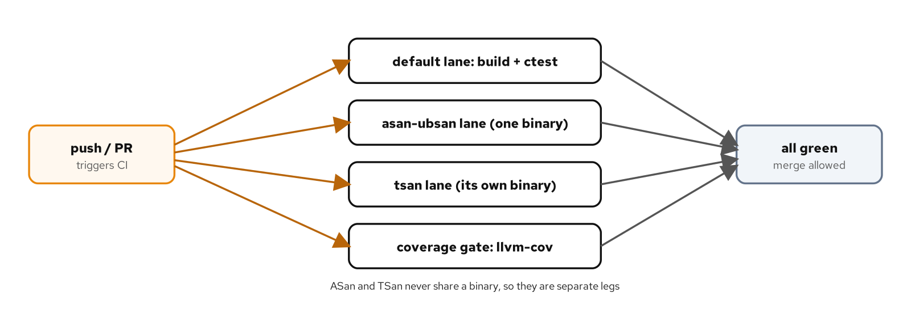
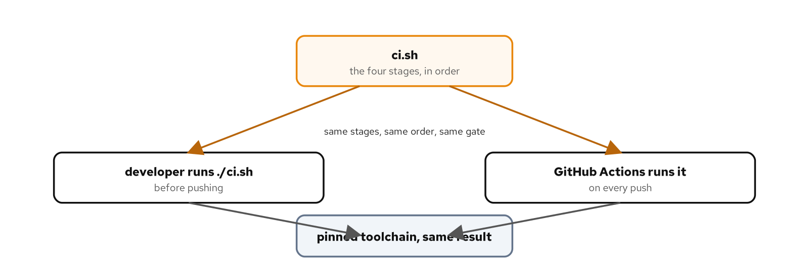

# CI and reproducible test runs

## Learning objectives

By the end of this chapter you can:

- Run the full test matrix from one script: the default lane, the two sanitizer lanes, and a coverage gate.
- Explain why ASan and TSan run as separate passes and never share a binary.
- Gate a build on a minimum coverage percentage that fails CI when it drops.
- Translate the local script into a GitHub Actions workflow that runs the same stages on every push.
- Pin the toolchain so a local run and a CI run produce the same result.

## Diagram



## Why this matters

The book has built up a set of checks: a suite that runs on the default build, the same suite under ASan and UBSan, the same suite under TSan, and a coverage report. Run by hand, one at a time, they're easy to skip under deadline, and the one you skip is the one that would've caught the bug. The point of continuous integration is to make skipping impossible: every push runs every check, the same way, and a failure blocks the merge. This chapter assembles the checks from the earlier chapters into one pipeline and runs it in two places, a developer's machine and GitHub Actions, from a single description.

The two places matter. A CI setup that runs checks a developer cannot reproduce locally is a source of friction: a red build with no way to debug it except by pushing again. The fix is to put the pipeline in a script the workflow calls, so the exact sequence that runs in CI also runs locally with one command. Then "green in CI" and "passes on my machine" stop being different claims. This chapter's example is small, a zone lookup with three tests, because the subject is the pipeline, not the code it checks.

The code is in `examples/16-ci/`. The run script there drives the whole matrix; its `README.md` covers the scripts and the workflow.

## How the code works

### One script for the whole matrix

`ci.sh` runs the four stages in order, and `set -euo pipefail` makes it stop on the first failure, so a red stage fails the whole run:

```bash
echo "== 1/4 default lane =="
conan install . -of build -s build_type=Debug -s compiler.cppstd=23 --build=missing
cmake --preset default && cmake --build --preset default
ctest --preset default --output-on-failure

echo "== 2/4 asan-ubsan lane =="
cmake --preset asan-ubsan && cmake --build --preset asan-ubsan
ASAN_OPTIONS=abort_on_error=1:halt_on_error=1 \
  ctest --preset asan-ubsan --output-on-failure

echo "== 3/4 tsan lane =="
cmake --preset tsan && cmake --build --preset tsan
TSAN_OPTIONS=halt_on_error=1 ctest --preset tsan --output-on-failure

echo "== 4/4 coverage gate =="
MIN_COVERAGE="${MIN_COVERAGE}" ./coverage.sh
```

Each lane configures its own preset into its own build directory, which is what keeps the sanitizers apart. ASan with UBSan builds into `build-asan`, TSan into `build-tsan`, and they never meet, because ASan and TSan instrument memory in incompatible ways and can't coexist in one binary. That is the two-pass rule from the sanitizer chapters made concrete: not a stylistic choice but a hard constraint, which is why the matrix in Figure 16.1 has the two as separate legs rather than one combined sanitizer build.

### The coverage gate

The fourth stage runs `coverage.sh`, which builds instrumented, reports with llvm-cov, and fails if coverage falls below a floor:

```bash
region=$(llvm-cov report ./build-cov/unit_tests \
  -instr-profile=build-cov/unit_tests.profdata src/shipping/zones.cpp \
  | awk '/^TOTAL/ {gsub("%","",$4); print $4}')
echo "region coverage: ${region}% (gate ${MIN_COVERAGE}%)"
awk -v got="$region" -v min="$MIN_COVERAGE" 'BEGIN { exit (got+0 >= min+0) ? 0 : 1 }' \
  || { echo "FAIL: coverage ${region}% is below the ${MIN_COVERAGE}% gate" >&2; exit 1; }
```

It parses the region percentage out of the `llvm-cov report` TOTAL line and compares it against `MIN_COVERAGE`, exiting non-zero when it's short. This is the regression-only gate from the coverage chapter: set the floor at the current number, and a change that adds untested code trips it, while the judgment of how much coverage is enough stays with the people writing the tests. The example runs green at 100% against a 90% gate; raising the gate past the actual coverage, `MIN_COVERAGE=101 ./ci.sh`, makes it fail, which is how you confirm the gate works rather than assuming it does.

### The same stages as a workflow

`workflows/tests.yml` is the GitHub Actions translation, and it runs the same commands. The three lanes become a build matrix, so they run in parallel:

```yaml
jobs:
  lanes:
    runs-on: ubuntu-latest
    strategy:
      fail-fast: false
      matrix:
        lane: [default, asan, tsan]
    steps:
      - uses: actions/checkout@v4
      - name: Install the toolchain
        run: |
          sudo apt-get update
          sudo apt-get install -y clang clang-tidy cmake ninja-build
          pipx install "conan==2.33.0"
      - name: Run the $ lane
        working-directory: examples/16-ci
        run: ./demo.sh $
```

`fail-fast: false` lets every lane finish even when one fails, so a run that breaks under TSan still tells you whether the default lane passed, rather than cancelling its siblings at the first red. The coverage gate is its own job running `coverage.sh`. The jobs install a pinned Conan, cache `~/.conan2` so GoogleTest is not rebuilt every run, and call the same scripts a developer runs, which is the whole point: the workflow is a thin wrapper around `ci.sh` and `coverage.sh`, not a second, divergent definition of the checks.

The workflow also declares `permissions: contents: read`, which drops the job's token to what the checks need, reading the code, and nothing more. A job that only builds and tests has no reason to write to the repository, and granting it less means a compromised dependency in the pipeline can do less. Least privilege is as much a CI practice as a runtime one, and the default token is broader than a test run requires.

### Making CI a gate, not a dashboard

A workflow that runs on every push is only advice until the checks are required. A branch protection rule, or a repository ruleset, marks the lane and coverage jobs as required to merge, so a pull request with a red TSan lane can't land however green the others are. The checks run either way; making them required is what turns CI from a dashboard into a gate. Pair it with a rule that the branch be up to date before merging, so each check passes against the code that will actually be on main rather than an older snapshot that happened to work.

Two triggers keep that gate responsive. Running on both `push` to main and `pull_request` checks a branch before and after it merges, which catches the case where two independently-green branches conflict once combined. A concurrency group keyed on the branch cancels a superseded run when a newer commit arrives, so a fast series of pushes doesn't queue a backlog of now-irrelevant runs. Neither changes what is checked, only when and how often.

### What else belongs in the pipeline

CI is where the cross-checks from across the book become routine. A second matrix leg that builds with GCC catches the warnings and conformance gaps Clang lets through, turning the occasional compiler cross-check into something that runs on every push. The professional-voice and idiomatic-review scans, and a clang-format check that fails on an unformatted diff, fit the same shape: each is a command that exits non-zero on a problem, which is all a CI step needs. The more of a project's standards are a failing exit code, the fewer depend on someone remembering to run them.

Not everything belongs on every push, though. The stress run from the flakiness chapter, `--gtest_repeat` over many iterations, is too slow for per-commit CI but fits a scheduled nightly job, which has the time to flush out a rare interleaving and the standing to fail loudly when it does. A `schedule` trigger runs it on a cron, apart from the per-push matrix, so the fast checks stay fast while the slow ones still run. The pipeline already emits results worth keeping, too: `gtest_discover_tests` writes JUnit-style XML to the output directory it was given, which CI can surface as a named test report instead of a wall of log text, and the coverage HTML tree can be uploaded as a build artifact a reviewer opens from the run.

> **AI sidebar.** Ask an assistant for a CI workflow and it will produce a plausible YAML that often drifts from how the project actually builds: a different compiler than the one the examples pin, an `apt-get install` of whatever is latest rather than the version under test, a coverage step that reports but never gates. Read the generated workflow against the local script and make it call that script rather than restating the build steps inline, because two copies of the build sequence drift apart the first time one changes. Watch for a workflow that runs the tests but asserts nothing about the result, a step that pipes output to a log and always exits zero, and for sanitizer lanes quietly merged into one job, which can't work because ASan and TSan need separate binaries. The workflow should fail when the tests fail; confirm that by reading what each step's exit status gates, not by trusting the green checkmark on a run where nothing was actually checked.

## Build, run, observe

Running the whole matrix locally is one command:

```bash
[host]$ cd examples/16-ci
[host]$ ./ci.sh
```

```console
== 1/4 default lane ==
100% tests passed, 0 tests failed out of 3
== 2/4 asan-ubsan lane ==
100% tests passed, 0 tests failed out of 3
== 3/4 tsan lane ==
100% tests passed, 0 tests failed out of 3
== 4/4 coverage gate (minimum 90% region) ==
region coverage: 100.00% (gate 90%)
== all stages passed ==
```

That output is what a CI run produces too, because CI runs the same script. The workflow itself is checked without running the whole cluster: `actionlint workflows/tests.yml` validates the YAML, the action references, and the expression syntax, which catches the common mistakes, a misindented step or a typo in a matrix variable, before a push rather than after a failed run.

## Reproducibility

A pipeline is only as trustworthy as its repeatability, so the toolchain is pinned, not floated. Conan pins `gtest/1.18.0` exactly, the workflow installs a fixed Conan version rather than whatever is newest, and the compiler, CMake, and Ninja are the versions the examples were built and verified against. The reason is that a floating dependency turns a green history red with no code change: a new GoogleTest minor version, a stricter compiler release, a changed default flag, any of which can break a build that passed yesterday. Pinning makes a failure mean a real change in the code, not a shift in the ground under it. The Conan cache keyed on `conanfile.py` reinforces this: the same inputs restore the same built dependencies, so CI isn't rebuilding, or silently re-resolving, its libraries on every run. The keying is the part to get right. A cache keyed too broadly serves stale libraries after a dependency bump; one keyed too narrowly rebuilds GoogleTest on every run, minutes wasted each time. Hashing the file that defines the dependencies invalidates the cache exactly when the inputs change and never otherwise.

One caveat applies to this book's toolchain. GitHub's hosted runners are Ubuntu with their own compiler versions, so a workflow that must match a pinned Clang 22 either installs it from the LLVM apt repositories or runs on a self-hosted runner that already carries the local toolchain. The pinning principle holds either way; only the mechanism for getting the pinned tools onto the runner changes, and the closer the runner's toolchain is to the one used locally, the less a green CI run can disagree with a green local one. Figure 16.2 is the result worth keeping in mind: one script, over a pinned toolchain, giving the same answer locally and in CI.



## Cross-check

Listing the cases shows the three tests the whole pipeline is built around:

```console
[host]$ ./build/unit_tests --gtest_list_tests
DeliveryZone.
  DomesticIsZoneOne
  EuAndUkAreZoneTwo
  EverywhereElseIsZoneThree
```

Three tests, one per branch of `delivery_zone`, which is why the coverage stage reports 100%: the small suite fully covers the small unit, and the pipeline around it is what this chapter was about.

## What you learned

- One script runs the whole matrix, the default lane plus both sanitizer lanes plus a coverage gate, and `set -euo pipefail` fails the run on the first red stage.
- ASan and TSan build into separate directories and run as separate passes, because they cannot share a binary.
- A coverage gate parses the report and exits non-zero below a floor; set the floor to the current number so a change that adds untested code fails CI.
- A GitHub Actions workflow runs the three lanes as a matrix and coverage as its own job, calling the same scripts a developer runs so local and CI results agree.
- Pin the toolchain and cache the dependencies so a red build means a code change, not a shift in versions.

That completes the pipeline, and the book. You started with a single `TEST`, added assertions and fixtures, parameterized and typed cases, the three failure mechanisms, the modern C++ features, mocks, concurrency and the sanitizers, and the tooling that debugs, measures, and runs it all. The through line is the same at every scale: a test is only worth the behavior it actually pins, and the job is to make the suite, the sanitizers, and the pipeline all say something true about the code.

## For deeper coverage

- The [GitHub Actions documentation](https://docs.github.com/en/actions): workflows, jobs, matrices, and caching.
- The [actionlint project](https://github.com/rhysd/actionlint): the workflow linter used here.
- *Software Engineering at Google* edited by Winters, Manshreck, and Wright ([O'Reilly](https://www.oreilly.com/library/view/software-engineering-at/9781492082781/)): continuous integration and testing at scale.
- The full reading list lives on the bibliography page.

---

*Verification status: verified. On Fedora 44 (Clang 22.1.8, CMake 4.3.0, Conan 2.33.0, GoogleTest 1.18.0, LLVM 22.1.8), `examples/16-ci` runs `./ci.sh` through all four stages green (3/3 on each lane, 100% region coverage above the 90% gate), and `workflows/tests.yml` passes `actionlint`. The GitHub Actions workflow is validated statically here, not executed on GitHub as part of this book. Re-run the pipeline before a release.*
